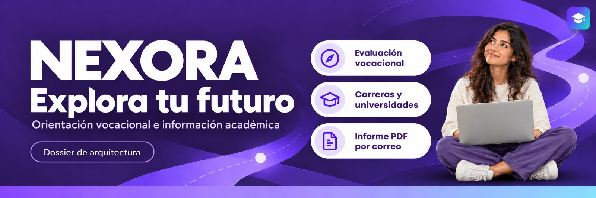

# 🎓 Nexora
### Dossier de arquitectura y Cadena CASE · Sistema web de orientación vocacional

**MAESTRÍA EN INGENIERÍA EN SOFTWARE**

| Información académica | Detalle |
|---|---|
| **Tarea** | Automatización de Procesos de Software · Semana 3, colaboración y control de versiones |
| **Módulo** | Automatización de Procesos de Software |
| **Docente** | Ing. José Luis Rodríguez Chinchilla, Mgs. |

### 👥 Integrantes

- Baren Tarira Rosa Angélica
- Herrera Celi Enrique Rolando
- Mera Rodríguez Willington Daniel

---

## 🎯 Acerca del proyecto

Nexora es un sistema web de orientación vocacional que permite al estudiante responder un cuestionario de 20 preguntas en escala Likert, consultar su diagnóstico vocacional en 10 áreas académicas, explorar carreras y universidades públicas del Ecuador y solicitar un informe formal en formato PDF por correo electrónico.

Este repositorio consolida la arquitectura del sistema, el contrato formal de interfaz OpenAPI 3.0, la cadena de herramientas CASE integrada y la implementación ejecutable del backend con sus pruebas automatizadas sobre PostgreSQL.

---

## 📚 Estructura de la Documentación y Artefactos

| Documento / Artefacto | Contenido y función en la entrega |
|---|---|
| [🧭 Contexto y drivers](docs/01-contexto-y-drivers/contexto-y-drivers.md) | Propósito, participantes (S1–S4), restricciones (R1–R6) y escenarios iniciales |
| [🌐 C4 nivel 1](docs/02-vistas-c4/nivel1.md) | Contexto de Nexora, actores y sistemas externos |
| [🧩 C4 nivel 2](docs/02-vistas-c4/nivel2.md) | Aplicación web, API modular, base de datos relacional y dependencias |
| [🔐 ADR-001](docs/03-adr/ADR-001-control-de-acceso.md) | Autenticación JWT y control de propiedad de los recursos |
| [💾 ADR-002](docs/03-adr/ADR-002.md) | Integridad transaccional e inmutabilidad histórica de evaluaciones |
| [🏗️ ADR-003](docs/03-adr/ADR-003-estilo-arquitectonico.md) | Selección de monolito modular con capas frente a microservicios |
| [🌿 ADR-004](docs/03-adr/ADR-004-control-de-versiones.md) | **(Semana 3)** Selección de Git, GitHub y GitHub Flow para el control de versiones |
| [⚖️ Matriz de decisión](docs/03-adr/matriz-de-decision.md) | Comparativa de estilos arquitectónicos de la Semana 1 |
| [🤖 Registro de IA](docs/04-registro-ia.md) | Bitácora de intervenciones de IA en Semanas 1, 2 y 3 con auditoría crítica |
| [🤝 Revisión cruzada](docs/05-revision-cruzada.md) | Registro de observaciones y validación entre equipos |
| [🛠️ Mapa de toolchain](docs/06-mapa-toolchain.md) | **(Semana 2)** Cadena CASE, 10 tareas priorizadas (F×E×R) y pruebas de herramientas Top |
| [📋 Historias y criterios](docs/07-historias-y-criterios.md) | **(Semana 2)** 4 historias HU, criterios Gherkin, revisión ISO 29148 y trazabilidad |
| [⚖️ Evaluación herramientas](docs/08-evaluacion-herramientas.md) | **(Semana 2)** Matriz ponderada de herramientas CASE (Spectral, Prism, Antigravity AI) |
| [📊 Matriz Git vs SVN](docs/08-matriz-git-vs-svn.md) | **(Semana 3)** Comparativa técnica en siete dimensiones y justificación de Git |
| [📄 Informe final CASE](docs/09-informe-cadena-case.md) | **(Semana 2)** Informe académico consolidado con todas las evidencias y resultados |
| [🔀 Conflicto de integración](docs/10-conflicto-integracion.md) | **(Semana 3)** Reporte del conflicto deliberado entre PR #8 y PR #10 y su resolución |
| [🏁 Cierre de Semana 3](docs/11-cierre-semana3.md) | **(Semana 3)** Consolidación del repositorio gobernado, cumplimiento de rúbrica y trazabilidad |
| [📖 Lecturas de apoyo](docs/lecturas-de-apoyo.md) | Síntesis de C4, ADR, ISO/IEC 14102, ISO/IEC/IEEE 29148 y Pro Git |
| [📘 Guía de contribución](CONTRIBUTING.md) | **(Semana 3)** Directrices de colaboración, ramas cortas, commits convencionales y revisiones |
| [📜 Contrato OpenAPI](api/openapi.yaml) | Especificación formal OpenAPI 3.0.3 con las 4 rutas y esquemas Pydantic |
| [🌐 Documentación API](docs/api/index.html) | Documentación interactiva compilada estáticamente con Redocly CLI |
| [📦 Stubs generados](generated/server/) | Andamiaje de servidor FastAPI generado con OpenAPI Generator |
| [💻 Servicio ejecutable](src/) | Implementación backend modular en FastAPI, SQLAlchemy, Argon2id y ReportLab |
| [🧪 Suite de pruebas](tests/) | 27 pruebas automatizadas con Pytest para verificar HU-01 a HU-04, E2 (rollback real en PostgreSQL), E5 (fallo SMTP controlado y aislamiento de simulación con monkeypatch.delenv), validación estricta del cuestionario con StrictInt (rechazo de booleanos, cadenas y flotantes con 422), carga explícita de `.env` y controles CA-01.2 / CA-04.2 |
| [📁 Evidencias reproducibles](evidencias/) | Salidas reales de validación Spectral, peticiones Mock y reportes de cobertura |

---

## 🔌 Cuatro endpoints del alcance analizado

| ID | Método | Endpoint | Responsabilidad funcional | Código de éxito |
|---|---|---|---|:---:|
| **EP1** | `POST` | `/api/v1/auth/login` | Iniciar sesión y emitir token Bearer JWT (Argon2id) | `200 OK` |
| **EP2** | `POST` | `/api/v1/evaluaciones` | Registrar atómicamente 20 respuestas Likert (StrictInt 0 a 4) y calcular 10 áreas | `201 Created` |
| **EP3** | `GET` | `/api/v1/evaluaciones/ultima` | Consultar la última evaluación propia (aislamiento estricto) | `200 OK` |
| **EP4** | `POST` | `/api/v1/informes/{id}/enviar-correo` | Generar informe PDF y despachar por SMTP tolerante a fallos | `200 OK` |

---

## 🛠️ Base tecnológica

| Componente | Tecnologías seleccionadas |
|---|---|
| **Backend API** | Python 3.11, FastAPI 0.141, Uvicorn 0.52 |
| **Persistencia** | PostgreSQL 18.4, SQLAlchemy 2.1, Psycopg2-binary |
| **Seguridad y Cifrado** | Argon2id (`argon2-cffi` v23.1, RFC 9106) y PyJWT Bearer |
| **Generación de Informes** | ReportLab 5.1 (renderizado en memoria `io.BytesIO`) |
| **Validación de Contratos** | Stoplight Spectral CLI 6.17 (`.spectral.yaml`) |
| **Simulación Mock** | Stoplight Prism CLI 5.15 |
| **Generación de Código** | OpenAPI Generator CLI 7.26 sobre Java OpenJDK 17 |
| **Documentación API** | Redocly CLI 1.26 |
| **Linter y Estilo** | Flake8 7.4 (`.flake8`) |
| **Pruebas Automatizadas** | Pytest 9.1, TestClient, Pytest-cov (92 % cobertura de código) |
| **Asistencia Cognitiva** | Antigravity AI Assistant (Google DeepMind) |
| **Control de Versiones** | Git y GitHub bajo GitHub Flow, con ramas cortas por tarea, commits convencionales, protección de main, revisión obligatoria por pares y etiquetas de versión |

---

## 👥 Flujo de colaboración

El equipo aplica el flujo de trabajo GitHub Flow adaptado a las directrices de Nexora detalladas en [CONTRIBUTING.md](CONTRIBUTING.md):

1. **Crear un issue por tarea:** Cada actividad de desarrollo o documentación cuenta con una incidencia previa en GitHub que define objetivo, criterios de aceptación y evidencias esperadas.
2. **Crear una rama corta desde main actualizado:** El autor sincroniza la rama principal local (`git pull --ff-only origin main`) y crea una rama específica con prefijos según la labor (`docs/`, `feat/`, `fix/`, `test/`).
3. **Crear commits convencionales con cambios coherentes:** Cada confirmación agrupa cambios atómicos y sigue el estándar convencional (`tipo(alcance): descripción`), con alcance opcional y validación técnica previa.
4. **Abrir un PR con Closes #n:** La integración hacia `main` se solicita mediante un Pull Request que completa la plantilla oficial y vincula el issue correspondiente para su cierre tras el merge.
5. **Obtener la aprobación de otro integrante y resolver las conversaciones:** Todo cambio requiere revisión sustantiva por pares, el autor atiende y resuelve cada observación hasta obtener al menos una aprobación formal.
6. **Integrar el PR y actualizar main local:** Tras la aprobación y resolución de hilos de discusión, se realiza el merge hacia `main` en GitHub y cada integrante actualiza su copia local de `main`.

---

## 📌 Estado de las evidencias (Semana 2)

| Elemento | Estado en v0.1.0 | Estado actual en v0.2.0 | Evidencia verificable |
|---|:---:|:---:|---|
| **Contrato OpenAPI y Reglas** | Pendiente | **Completado y Validado** | [`evidencias/contrato/spectral-validation.txt`](evidencias/contrato/spectral-validation.txt) (0 errores) |
| **Simulación Mock de API** | Pendiente | **Completado y Consultado** | [`evidencias/contrato/mock-requests.json`](evidencias/contrato/mock-requests.json) (4 rutas respondidas) |
| **Stubs de Servidor** | Pendiente | **Generado** | [`generated/server/`](generated/server/) (35 archivos producidos) |
| **Servicio Backend Ejecutable** | Pendiente | **Operativo en vivo** | [`evidencias/pruebas/backend-startup-log.txt`](evidencias/pruebas/backend-startup-log.txt) (`/health` OK) |
| **Análisis Estático (Linter)** | Pendiente | **0 violaciones** | [`evidencias/pruebas/linter-output.txt`](evidencias/pruebas/linter-output.txt) |
| **Pruebas Automatizadas (Pytest)** | Pendiente | **27/27 Aprobadas** (92 % cobertura código; rollback real E2, aislamiento SMTP estricto y StrictInt) | [`evidencias/pruebas/pytest-results.txt`](evidencias/pruebas/pytest-results.txt) |

---

## 🚀 Guía de Reproducción de la Cadena CASE

Siga estos pasos para reproducir la cadena de herramientas:

### 1. Requisitos previos

- **Python:** 3.11 o superior.
- **Node.js:** v20 o superior (con `npx` habilitado).
- **PostgreSQL:** Versión 16 a 18 en ejecución local en el puerto 5432.
- **Java JRE/JDK:** Versión 17 o superior (para OpenAPI Generator).

### 2. Configuración de Base de Datos Aislada y Variables de Entorno

Para aislar las pruebas de la base principal y de los datos de producción:

```sql
-- Ejecutar en PostgreSQL local (puerto 5432):
CREATE DATABASE nexora_test_semana2;
```

> [!IMPORTANT]
> **Seguridad de aislamiento:** `tests/conftest.py` valida que `engine.url.database == "nexora_test_semana2"` mediante igualdad exacta y que `ENVIRONMENT == "testing"`, si se apunta a cualquier otra base, el arnés de pruebas aborta con `RuntimeError` antes de ejecutar cualquier operación DDL (`drop_all`/`create_all`).
>
> `src/main.py` utiliza el ciclo de vida `lifespan` de FastAPI y omite `create_all()` durante pruebas, la inicialización solo se realiza tras validar el destino.

#### Opción A: Configuración mediante comandos PowerShell

Configure las variables de sesión en PowerShell antes de arrancar o probar:

```powershell
# Variables para el servicio en desarrollo:
$env:SECRET_KEY="clave_secreta_jwt_de_al_menos_32_caracteres_nexora_2026"
$env:DB_NAME="nexora_semana2"
$env:DB_USER="postgres"
$env:PGPASSWORD="tu_password_postgres"

# Variables para la suite de pruebas aislada:
$env:PGPASSWORD="tu_password_postgres"
$env:DB_NAME="nexora_test_semana2"
```

#### Opción B: Carga explícita mediante archivo `.env`

La función `os.getenv` de la biblioteca estándar de Python no lee archivos `.env` de forma nativa, `src/core/config.py` implementa la función `_load_env_file()`, la cual lee y carga explícitamente las variables desde `.env` al inicializar la configuración, sin sobrescribir variables ya definidas en el entorno del sistema.

```bash
# Copiar la plantilla no secreta
cp .env.example .env
```

Edite `.env` y defina `SECRET_KEY`, `DB_NAME`, `DB_USER` y `PGPASSWORD`.

### 3. Instalación de dependencias

```bash
# Instalar paquetes requeridos de Python
python -m pip install -r requirements.txt
```

### 4. Validación de gobernanza del contrato OpenAPI (Spectral)

```bash
npx -y @stoplight/spectral-cli lint api/openapi.yaml --ruleset .spectral.yaml
```

*Resultado esperado:* `No results with a severity of 'error' found!`

### 5. Simulación Mock y consulta desacoplada (Prism)

```bash
# Terminal 1: Iniciar el servidor mock en el puerto 4010
npx -y @stoplight/prism-cli mock api/openapi.yaml -p 4010 -h 127.0.0.1

# Terminal 2: Realizar solicitudes HTTP reales de prueba
curl -X POST http://127.0.0.1:4010/api/v1/auth/login -H "Content-Type: application/json" -d "{\"email\":\"estudiante.demo@ejemplo.edu.ec\",\"password\":\"ClaveSegura2026.\"}"
curl -X GET http://127.0.0.1:4010/api/v1/evaluaciones/ultima -H "Authorization: Bearer mock-token"
```

### 6. Compilación de documentación interactiva (Redocly)

```bash
npx -y @redocly/cli build-docs api/openapi.yaml --output docs/api/index.html
```

### 7. Generación de stubs de servidor (OpenAPI Generator)

```bash
npx -y @openapitools/openapi-generator-cli generate -i api/openapi.yaml -g python-fastapi -o generated/server/ --additional-properties=packageName=nexora_server_stubs
```

### 8. Verificación de calidad estática y estilo (Flake8)

```bash
python -m flake8 src tests
```

*Resultado esperado:* 0 advertencias ni errores (código de salida 0).

### 9. Ejecución de pruebas automatizadas sobre PostgreSQL aislado (Pytest)

```powershell
# Configurar la contraseña de PostgreSQL del entorno local y ejecutar la suite con cobertura
$env:PGPASSWORD="tu_password_postgres"
python -m pytest tests -v --cov=src
```

*Resultado esperado:* 27 pruebas aprobadas (100 %) y cobertura del 92 %.

Las fixtures de prueba inyectan una clave sintética de pruebas (`SECRET_KEY`), verifican con igualdad exacta `nexora_test_semana2` y activan expresamente `MODO_PRUEBAS_SIMULACION_CORREO=true` en memoria para evitar que las pruebas contacten servidores SMTP reales o dependan de secretos fijos.

### 10. Arranque del servicio ejecutable (Uvicorn)

Fuera del entorno de pruebas, el servicio exige configurar `SECRET_KEY`, `DB_NAME` y `PGPASSWORD` en el entorno o archivo `.env`:

```powershell
$env:SECRET_KEY="clave_secreta_jwt_de_al_menos_32_caracteres_nexora_2026"
$env:DB_NAME="nexora_semana2"
$env:PGPASSWORD="tu_password_postgres"
python -m uvicorn src.main:app --host 127.0.0.1 --port 8002 --reload
```

Acceda en el navegador a:

- Documentación Swagger interactiva: `http://127.0.0.1:8002/docs`
- Diagnóstico de salud: `http://127.0.0.1:8002/health`

---

## 🛡️ Cobertura de Escenarios de Calidad del Dossier

El 92 % de cobertura de código corresponde a las pruebas con `pytest`, la evaluación de los escenarios de calidad del dossier se presenta por separado según la evidencia disponible:

| Escenario original | Meta y medida del dossier base | Prueba técnica ejecutada | Cobertura alcanzada | Comprobación pendiente |
|---|---|---|:---:|---|
| **E1 (Seguridad)** | 100 intentos de modificación del catálogo rechazados con **HTTP 403** y 0 cambios en DB. | El alcance de entrega EP1–EP4 no incluye la ruta de edición del catálogo general, se implementó una prueba complementaria de propiedad y autorización en informes (CA-04.2: 100 intentos ajenos rechazados con HTTP 403), esta prueba no verifica el rechazo de modificaciones al catálogo de carreras y universidades. | **Sin evaluación directa** | Implementar el endpoint de catálogo y ejecutar una suite contra 100 intentos de modificación no autorizados. |
| **E2 (Integridad)** | 30 fallos inducidos en persistencia, con **0 evaluaciones parciales** y 0 alteraciones. | 30 iteraciones con payload válido (20 preguntas Likert 0..4) e inyección de fallo (`INDUCIR_FALLO_TRANSACCION_E2="true"`) tras `flush()` de escritura no confirmada en PostgreSQL 18.4 real (`nexora_test_semana2`), se confirmó rollback a nivel de DB, consulta en sesión nueva con 0 registros parciales calculados y preservación íntegra de la evaluación histórica previa. | **Total en alcance EP2** | Inyección de fallo a nivel de caída de proceso o desconexión de red en staging. |
| **E3 (Desempeño)** | 100 usuarios virtuales durante 10 minutos (2 vCPU, 4 GB RAM), **P95 ≤ 2 s** y errores **< 1 %**. | Verificación funcional unitaria de consulta aislada de última evaluación (`test_obtener_ultima_evaluacion_propia`). | **Sin evaluación de carga** | Prueba de estrés sostenido con k6 o Locust durante 10 minutos. |
| **E4 (Mantenibilidad)** | Cambio de reglas en **≤ 4 h**, **≤ 3 archivos de producción** y 100 % de pruebas de regresión aprobadas. | Se modularizó el cálculo vocacional en `src/services/evaluacion_service.py` y se almacena `version_cuestionario = "3.0-20preguntas"`, guardar la versión en base de datos no demuestra por sí solo modularidad arquitectónica, inmutabilidad de cálculos históricos ante cambios de reglas ni el tiempo de cambio de ≤ 4 h. | **Sin evaluación empírica** | Medición cronometrada de mantenimiento en un sprint con cambio real de reglas y verificación de no regresión en el histórico. |
| **E5 (Continuidad)** | Indisponibilidad SMTP por 10 min, **≥ 99 % consultas correctas** y 20 respuestas controladas. | Captura de excepción SMTP, retorno de HTTP 503 controlado sin caída de API y continuidad de EP1 y EP3, la simulación solo opera con activación explícita en testing, fuera de testing o sin credenciales se produce un error 503 controlado. | **Parcial** | Prueba de resistencia de 10 min con mock SMTP bloqueado y tráfico concurrente. |
| **E6 (Usabilidad móvil)** | Al menos 9 de 10 estudiantes completan el test en móvil de 360 px en **≤ 8 min** sin asistencia. | No aplica a la API de backend, corresponde a la interfaz web móvil en React. | **Sin evaluación** | Sesión de usabilidad con 10 usuarios en dispositivos móviles. |

---

## 🕓 Historial de cambios y entrega

El historial completo de transiciones se encuentra en el archivo [CHANGELOG.md](CHANGELOG.md).

La versión `v0.2.0` corresponde a la entrega académica anterior, mientras que las actividades de la Semana 3 se encuentran en preparación.

---

**🌿 Nexora · Orientación vocacional rigurosa, auditable y basada en estándares**
