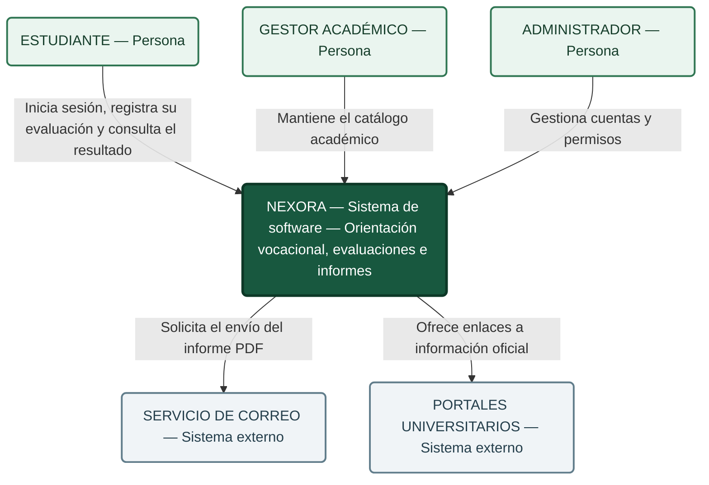

# C4 nivel 1. Contexto del sistema Nexora

## Propósito

Nexora es un sistema web de orientación vocacional que permite al estudiante responder un cuestionario, consultar su evaluación y solicitar un informe PDF por correo, el sistema presenta información de carreras y universidades para apoyar la exploración académica, sus resultados son orientativos y no garantizan admisión ni afinidad profesional definitiva.

## Alcance de la vista

La vista representa a Nexora como un único sistema y muestra sus relaciones con las personas y los sistemas externos, el alcance académico de esta entrega comprende cuatro endpoints, la administración y el mantenimiento del catálogo se incluyen como contexto general.

## Diagrama de contexto

**Nota.** Elaboración propia para Nexora, la relación con los portales representa enlaces hacia información oficial y no una integración automática mediante API, el servicio de correo procesa el envío del informe al destinatario.

## Participantes y responsabilidades

| ID | Participante | Responsabilidad o relación |
|---|---|---|
| S1 | Estudiante | Iniciar sesión, responder el cuestionario, consultar su última evaluación y solicitar el informe |
| S2 | Administrador | Gestionar cuentas y permisos conforme a las políticas del sistema |
| S4 | Servicio externo de correo | Procesar la solicitud de envío y entregar el mensaje al destinatario |
| S5 | Gestor de información académica | Mantener la vigencia y exactitud del catálogo de carreras, universidades y enlaces oficiales |
| S6 | Portales oficiales de universidades | Proporcionar información oficial accesible mediante los enlaces del catálogo y servir como fuentes de verificación |

El equipo de desarrollo, identificado como S3 en el contexto y los drivers, participa en la construcción y el mantenimiento, su interés se documenta como stakeholder y no requiere una relación de uso en esta vista.

Las funciones del administrador y del gestor pertenecen al contexto general del sistema, su presencia en el diagrama no incorpora operaciones adicionales al alcance de los cuatro endpoints del deber.

## Relaciones del contexto

| Origen | Destino | Relación |
|---|---|---|
| Estudiante | Nexora | Iniciar sesión, registrar la evaluación, consultar el resultado y solicitar el informe |
| Gestor académico | Nexora | Mantener el catálogo académico y sus enlaces oficiales |
| Administrador | Nexora | Gestionar cuentas y permisos |
| Nexora | Servicio de correo | Solicitar el envío del mensaje con el informe PDF |
| Nexora | Portales universitarios | Ofrecer enlaces hacia información académica oficial |

La entrega del informe al estudiante corresponde al servicio de correo y se explica en la descripción del contexto, el diagrama mantiene tres actores en la fila superior, Nexora al centro y dos sistemas externos en la fila inferior para facilitar su lectura.

## Operaciones incluidas en el análisis

| ID | Método | Endpoint | Función |
|---|---|---|---|
| EP1 | POST | `/api/v1/auth/login` | Iniciar sesión |
| EP2 | POST | `/api/v1/evaluaciones/` | Enviar las respuestas y registrar la evaluación |
| EP3 | GET | `/api/v1/evaluaciones/ultima` | Consultar la última evaluación y su resultado |
| EP4 | POST | `/api/v1/informes/{id}/enviar-correo` | Enviar el informe PDF al correo |

**Nota.** La tabla delimita las cuatro operaciones del deber, los endpoints de administración y catálogo quedan fuera de este análisis, la relación entre el identificador de EP4 y la evaluación requiere verificación en OpenAPI.

## Límites y condiciones

- Nexora autentica al estudiante y verifica la propiedad de los recursos en las operaciones protegidas.
- El proveedor de correo permanece fuera del límite del sistema.
- La aceptación de una solicitud por el proveedor no garantiza su recepción en la bandeja del destinatario.
- Los portales universitarios constituyen fuentes externas de información.
- Los enlaces oficiales no implican extracción automática ni sincronización con las universidades.
- El mantenimiento del catálogo no supone acceso del gestor a resultados privados.
- El registro de cuentas se considera una condición previa al flujo analizado.
- La correspondencia exacta de las rutas con la API requiere verificación mediante OpenAPI.

## Relación con los drivers

| Driver | Relación con el contexto |
|---|---|
| D1. Seguridad | Proteger respuestas, resultados e informes del estudiante |
| D2. Fiabilidad e integridad | Conservar la evaluación y su historial |
| D3. Desempeño | Responder oportunamente a las operaciones del estudiante |
| D4. Mantenibilidad | Permitir cambios localizados en reglas e integraciones |
| D5. Continuidad ante fallos de correo | Mantener el flujo principal ante la indisponibilidad del proveedor |

## Estado de la vista

La vista documenta el contexto acordado para el dossier, las relaciones y los controles requieren contraste con el código y las pruebas antes de declarar su cumplimiento, los escenarios de calidad mantienen su estado pendiente hasta disponer de evidencias de ejecución.

## Documentación relacionada

- [Parte 1: contexto, drivers y escenarios de calidad](../01-contexto-y-drivers/contexto-y-drivers.md)
- [C4 nivel 2: contenedores](nivel2.md)
- [Decisiones arquitectónicas](../03-adr/)
- [Matriz de decisión](../03-adr/matriz-de-decision.md)
