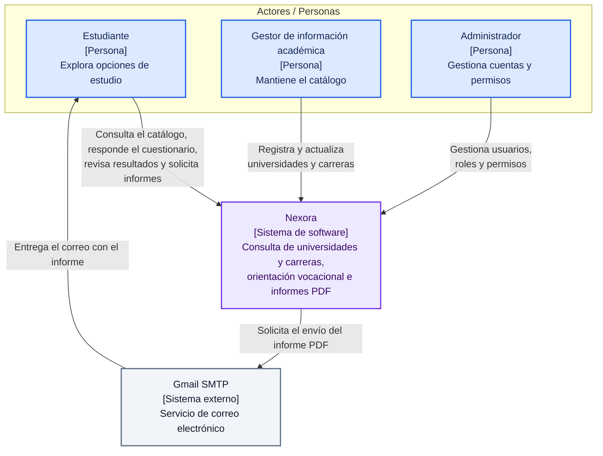

# C4 — Nivel 1: Contexto de Nexora

## Descripción

Nexora es un sistema web de orientación vocacional y consulta de universidades y carreras del Ecuador, permite al estudiante explorar la oferta académica, responder el cuestionario vocacional, consultar sus resultados y obtener informes PDF, el gestor mantiene la información académica y el administrador gestiona las cuentas y sus permisos.

## Diagrama de contexto

## Actores y responsabilidades

| Actor | Responsabilidad | Interesado relacionado |
|---|---|---|
| Estudiante | Consultar el catálogo, responder el cuestionario, revisar su historial y obtener sus informes | ST-01 |
| Gestor de información académica | Registrar y actualizar universidades y carreras con información verificable | ST-02 |
| Administrador | Gestionar cuentas, roles y permisos | ST-03 |

## Sistema externo

| Sistema | Relación con Nexora | Dependencia |
|---|---|---|
| Gmail SMTP | Recibir solicitudes de envío y entregar correos con informes PDF | Su indisponibilidad debe permitir que continúen las consultas del sistema, según E5 |

## Límite del sistema

Nexora comprende la interfaz, las reglas de evaluación, la gestión del catálogo, la generación de informes y la persistencia, Gmail SMTP pertenece a un proveedor externo, las universidades representan información del catálogo y esta vista no supone una conexión automática con sus plataformas.

La relación de entrega del correo representa el propósito del servicio externo, la aceptación de un mensaje por SMTP no demuestra su recepción en la bandeja de entrada.

## Relación con los drivers

| Driver | Relación con la vista |
|---|---|
| D1 — Seguridad | Cada actor dispone de funciones según sus permisos y el estudiante accede a sus propios resultados |
| D2 — Fiabilidad | Nexora conserva las evaluaciones y su historial |
| D3 — Eficiencia de desempeño | El estudiante requiere respuestas oportunas al consultar el catálogo |
| D4 — Mantenibilidad | El catálogo y las reglas vocacionales requieren cambios controlados |
| D5 — Disponibilidad | Las consultas deben continuar ante una falla del correo |
| D6 — Capacidad de interacción | El estudiante necesita comprender y completar el cuestionario |

## Documentos relacionados

- [Contexto y drivers](../01-contexto-y-drivers/contexto-y-drivers.md)
- [Escenarios de calidad](../01-contexto-y-drivers/escenarios-de-calidad.md)
- [C4 nivel 2: contenedores](nivel2.md)