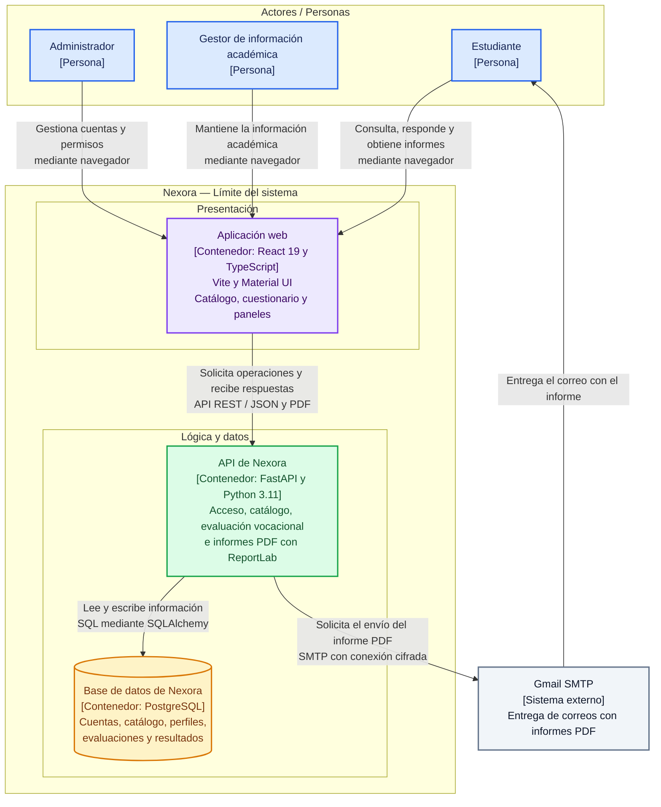

# C4 — Nivel 2: Contenedores de Nexora

## Descripción

Nexora dispone de una aplicación web con React 19 y TypeScript, una API con FastAPI y Python 3.11, y una base de datos PostgreSQL, la API procesa las evaluaciones, genera informes PDF con ReportLab y solicita su envío mediante Gmail SMTP.

La vista representa los contenedores de ejecución y almacenamiento, las agrupaciones de presentación, lógica y datos permiten identificar sus responsabilidades.

## Diagrama de contenedores

## Responsabilidades de los contenedores

| Contenedor | Tecnología | Responsabilidad |
|---|---|---|
| Aplicación web | React 19, TypeScript y Material UI, con Vite como herramienta de desarrollo y construcción | Presentar el catálogo, cuestionario, progreso, resultados, historial y paneles |
| API de Nexora | FastAPI y Python 3.11 | Validar solicitudes, autenticar usuarios, aplicar permisos y reglas vocacionales, consultar datos y generar informes |
| Base de datos de Nexora | PostgreSQL | Conservar cuentas, catálogo académico, perfiles, evaluaciones y resultados |

## Bibliotecas y herramientas del backend

| Tecnología | Responsabilidad |
|---|---|
| SQLAlchemy | Acceder a PostgreSQL y definir operaciones de persistencia |
| Alembic | Versionar y aplicar cambios del esquema de datos |
| Pydantic | Validar los datos de intercambio de la API |
| PyJWT | Generar y verificar tokens de autenticación |
| Argon2id | Proteger contraseñas mediante hash |
| ReportLab | Generar informes vocacionales en PDF |
| Geopy | Apoyar las funciones geográficas del proyecto |

Estas bibliotecas forman parte del backend y no constituyen contenedores independientes, Alembic es una herramienta de migraciones, el envío de correo se representa como una integración de FastAPI con Gmail SMTP.

## Relaciones y protocolos

| Origen | Destino | Información intercambiada | Protocolo o mecanismo |
|---|---|---|---|
| Actores | Aplicación web | Acciones de consulta, evaluación y gestión | Navegador web |
| Aplicación web | API de Nexora | Solicitudes, respuestas y descarga de informes | HTTP en desarrollo local, HTTPS como requisito del despliegue público, JSON y PDF |
| API de Nexora | PostgreSQL | Consultas y operaciones de persistencia | Protocolo de PostgreSQL y SQL mediante SQLAlchemy |
| API de Nexora | Gmail SMTP | Mensaje e informe adjunto | SMTP con conexión cifrada |
| Gmail SMTP | Estudiante | Correo con informe PDF | Entrega de correo al destinatario |

## Entorno local reportado

| Elemento | Dirección o nombre |
|---|---|
| Aplicación web | http://localhost:5173 |
| API de Nexora | http://127.0.0.1:8002 |
| Prefijo de endpoints | /api/v1 |
| Base de datos | orientacion_vocacional_db |
| Puerto de PostgreSQL | 5432 |

Las direcciones corresponden al entorno local de desarrollo y no representan direcciones de publicación.

## Relación con los escenarios de calidad

| Escenario | Contenedores relacionados | Responsabilidad arquitectónica |
|---|---|---|
| E1 — Seguridad | Aplicación web, API y PostgreSQL | Aplicar la autorización en la API y evitar modificaciones sin permiso |
| E2 — Fiabilidad | API y PostgreSQL | Conservar la atomicidad del registro de respuestas y resultados |
| E3 — Eficiencia de desempeño | API y PostgreSQL | Resolver consultas paginadas del catálogo bajo la carga definida |
| E4 — Mantenibilidad | API y PostgreSQL | Localizar las reglas vocacionales y conservar el significado del historial |
| E5 — Disponibilidad | API, PostgreSQL y Gmail SMTP | Contener los errores del correo sin interrumpir las consultas |
| E6 — Capacidad de interacción | Aplicación web y API | Presentar cuatro bloques de cinco preguntas, conservar respuestas y mostrar el progreso |

## Consistencia con el nivel 1

- Se conservan los actores estudiante, gestor de información académica y administrador
- La aplicación web, la API y PostgreSQL pertenecen al límite de Nexora
- Gmail SMTP permanece fuera del límite del sistema
- Los informes PDF se generan dentro de la API mediante ReportLab
- Las consultas del catálogo utilizan la información que conserva PostgreSQL

## Estado de verificación

Las tecnologías corresponden al historial reportado del proyecto, las responsabilidades asociadas a los escenarios representan requisitos arquitectónicos cuya cobertura requiere revisión del código y pruebas, esta vista no acredita por sí sola el cumplimiento de las medidas de calidad.

## Documentos relacionados

- [C4 nivel 1: contexto](nivel1.md)
- [Contexto y drivers](../01-contexto-y-drivers/contexto-y-drivers.md)
- [Escenarios de calidad](../01-contexto-y-drivers/escenarios-de-calidad.md)
- [ADR-001: control de acceso](../03-adr/ADR-001-control-de-acceso.md)
- [Matriz de decisión](../03-adr/matriz-de-decision.md)