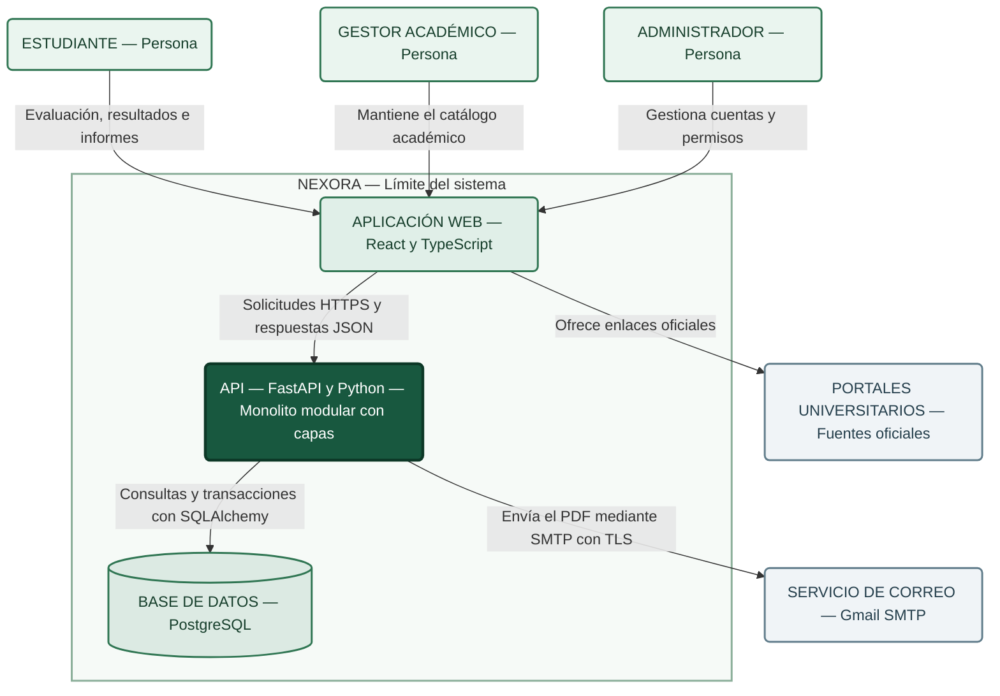

# C4 nivel 2. Contenedores del sistema Nexora

## Propósito

La vista de contenedores describe la aplicación web, la API y la base de datos de Nexora, muestra las tecnologías y responsabilidades de cada elemento y su relación con el servicio externo de correo.

## Alcance de la vista

La arquitectura seleccionada en el dossier corresponde a un monolito modular con capas en el backend, las capacidades de acceso, evaluaciones, resultados e informes pertenecen a una misma API y comparten su despliegue.

El análisis comprende los cuatro endpoints acordados, las funciones del administrador y del gestor académico aparecen como contexto general y no amplían el alcance de esta entrega.

## Diagrama de contenedores

**Nota.** Elaboración propia para Nexora, la aplicación web, la API y PostgreSQL pertenecen al límite del sistema, el correo y los portales universitarios son externos, los enlaces a universidades no representan una integración automática mediante API.

## Contenedores y responsabilidades

| Elemento | Tecnología | Responsabilidad |
|---|---|---|
| Aplicación web | React, TypeScript, Vite y Material UI | Presentar el cuestionario, enviar respuestas, mostrar resultados, solicitar informes y ofrecer acceso al catálogo |
| API | Python y FastAPI | Autenticar, comprobar permisos y propiedad, procesar evaluaciones, consultar resultados, generar el PDF y solicitar su envío |
| Base de datos | PostgreSQL | Conservar cuentas, evaluaciones, respuestas, resultados e información académica |

**Nota.** El término contenedor del modelo C4 representa una aplicación o almacén de datos, no exige que cada elemento utilice Docker.

## Sistemas externos

| Sistema | Relación con Nexora | Límite de responsabilidad |
|---|---|---|
| Servicio de correo | Recibir la solicitud de envío del mensaje con el informe PDF | Nexora depende del proveedor para la entrega del correo |
| Portales universitarios | Proporcionar información oficial accesible mediante enlaces del catálogo | Nexora no controla la disponibilidad ni el contenido de esos sitios |

La aplicación web ofrece los enlaces a los portales oficiales para su apertura en el navegador, el gestor utiliza esas fuentes para verificar la información del catálogo.

## Organización interna de la API

| Capacidad | Responsabilidad | Endpoint del alcance |
|---|---|---|
| Acceso | Validar credenciales y proporcionar el mecanismo de autenticación para las operaciones protegidas | EP1 |
| Evaluaciones | Validar respuestas, aplicar las reglas y registrar la evaluación con su resultado | EP2 |
| Resultados | Recuperar la última evaluación del estudiante autenticado | EP3 |
| Informes | Verificar la propiedad del recurso, generar el PDF y solicitar su envío | EP4 |

La separación por capas distingue la recepción de solicitudes, la lógica de aplicación, las reglas de evaluación y el acceso a datos e integraciones, estas responsabilidades permanecen dentro de la API y no constituyen microservicios independientes.

SQLAlchemy corresponde al acceso a PostgreSQL y ReportLab a la generación del informe PDF, ambas herramientas pertenecen al backend y no requieren contenedores adicionales en esta vista.

## Endpoints incluidos en el análisis

| ID | Método | Endpoint | Función |
|---|---|---|---|
| EP1 | POST | `/api/v1/auth/login` | Iniciar sesión |
| EP2 | POST | `/api/v1/evaluaciones/` | Enviar las respuestas y registrar la evaluación |
| EP3 | GET | `/api/v1/evaluaciones/ultima` | Consultar la última evaluación y su resultado |
| EP4 | POST | `/api/v1/informes/{id}/enviar-correo` | Enviar el informe PDF al correo |

**Nota.** La correspondencia exacta de las rutas y la relación entre el identificador de EP4 y la evaluación requieren verificación mediante OpenAPI.

## Relaciones y comunicaciones

| Origen | Destino | Comunicación | Propósito |
|---|---|---|---|
| Estudiante | Aplicación web | Navegador web | Acceder al cuestionario, resultados y solicitud de informe |
| Gestor académico | Aplicación web | Navegador web | Mantener la información académica |
| Administrador | Aplicación web | Navegador web | Gestionar cuentas y permisos |
| Aplicación web | API | HTTPS y contrato de datos de la API | Ejecutar las operaciones del sistema |
| API | PostgreSQL | Conexión mediante SQLAlchemy | Consultar y persistir datos |
| API | Servicio de correo | SMTP con TLS | Solicitar el envío del informe PDF |
| Aplicación web | Portales universitarios | Enlaces web | Facilitar el acceso a información oficial |

## Flujo de evaluación e informe

1. El estudiante inicia sesión desde la aplicación web mediante EP1.
2. La aplicación envía las respuestas del cuestionario mediante EP2.
3. La API valida las respuestas y aplica las reglas de evaluación.
4. PostgreSQL conserva la evaluación, sus respuestas y el resultado asociado.
5. La aplicación consulta la última evaluación mediante EP3.
6. El estudiante solicita el envío del informe mediante EP4.
7. La API comprueba la propiedad del recurso y genera el PDF con ReportLab.
8. La API solicita el envío del mensaje mediante Gmail SMTP.

El envío del informe utiliza la evaluación persistida, la solicitud no debe crear otra evaluación ni modificar el resultado histórico.

## Controles y tácticas del diseño

| Driver | Control o táctica prevista | Escenario relacionado |
|---|---|---|
| D1. Seguridad | Autenticar en la API y comprobar la propiedad antes de consultar resultados o enviar informes | E1 para el informe, con pruebas específicas adicionales para otras operaciones protegidas |
| D2. Fiabilidad e integridad | Registrar evaluación, respuestas y resultado mediante una transacción con reversión ante fallos | E2 |
| D3. Desempeño | Delimitar las consultas al estudiante y revisar el acceso a datos mediante pruebas de carga | E3 |
| D4. Mantenibilidad | Separar las reglas y conservar la versión del cuestionario y de las reglas asociada al resultado | E4 |
| D5. Continuidad ante fallos de correo | Limitar el tiempo de espera y controlar los errores del proveedor | E5 |

**Nota.** Los controles describen el diseño del dossier, su eficacia requiere inspección del código y ejecución de pruebas.

## Tratamiento del correo

La integración de correo pertenece a la API, el diseño contempla un tiempo de espera limitado y una respuesta de error controlada ante la indisponibilidad del proveedor, el sistema no debe informar un envío exitoso si la solicitud falla.

La continuidad de EP1, EP2 y EP3 durante un fallo SMTP requiere verificación mediante E5, la aceptación del mensaje por el proveedor no garantiza su recepción en la bandeja del estudiante.

El diseño seleccionado no incorpora una cola persistente, un broker ni un consumidor independiente, esos elementos pertenecen a la alternativa A3 evaluada en la matriz de decisión, su adopción exige revisar la decisión si surge la necesidad de entrega recuperable.

## Relación con las decisiones arquitectónicas

| Decisión | Efecto en la vista |
|---|---|
| ADR-001. Control de acceso | Sitúa la autenticación y la autorización sobre los recursos en la API |
| ADR-002. Integridad de evaluaciones | Define la persistencia coherente de evaluación, respuestas y resultado en PostgreSQL |
| ADR-003. Estilo arquitectónico | Mantiene las capacidades del backend en un monolito modular con capas |

## Límites y condiciones

- La aplicación web accede a los datos a través de la API.
- PostgreSQL no se expone directamente a la interfaz.
- La API aplica los controles de autorización.
- Las credenciales de correo pertenecen a la configuración del backend.
- La generación del PDF permanece dentro de la API.
- Los cambios de reglas deben conservar los resultados históricos.
- El administrador y el gestor utilizan funciones ajenas al alcance específico de EP1–EP4.
- Los enlaces universitarios no implican sincronización automática del catálogo.

## Estado de validación

| Aspecto | Estado | Evidencia requerida |
|---|---|---|
| Contrato de EP1–EP4 | Pendiente de verificación | OpenAPI y solicitudes de prueba |
| Organización del backend | Pendiente de inspección | Estructura del código y dependencias |
| Control de propiedad del informe | Pendiente de ejecución de E1 | Registro de rechazos y ausencia de envíos |
| Integridad transaccional | Pendiente de ejecución de E2 | Fallos inducidos y consultas de integridad |
| Desempeño de consulta | Pendiente de ejecución de E3 | Informe de carga y configuración del entorno |
| Cambio de reglas | Pendiente de ejecución de E4 | Diferencias de código, tiempo y regresión |
| Continuidad ante fallos SMTP | Pendiente de ejecución de E5 | Registros del fallo y de las operaciones principales |

La vista representa la arquitectura seleccionada en el dossier, su correspondencia con el sistema real y el cumplimiento de los escenarios requieren evidencias antes de declararse verificados.

## Documentación relacionada

- [C4 nivel 1: contexto](nivel1.md)
- [Parte 1: contexto, drivers y escenarios de calidad](../01-contexto-y-drivers/contexto-y-drivers.md)
- [Decisiones arquitectónicas](../03-adr/)
- [Matriz de decisión](../03-adr/matriz-de-decision.md)
