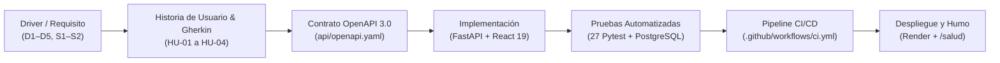

# 🔗 Matriz de Trazabilidad Integral del Proyecto Nexora

| Metadato | Detalle |
|---|---|
| **Proyecto** | Nexora · Sistema web de orientación vocacional |
| **Módulo** | Automatización de Procesos de Software |
| **Nivel** | Maestría en Ingeniería en Software · UPEC |
| **Propósito** | Demostrar la trazabilidad bidireccional entre drivers, historias ISO/IEC/IEEE 29148, contrato OpenAPI 3.0, código frontend y backend, pruebas automatizadas, commits de Git, pull requests y jobs del pipeline CI/CD |

---

## 1. Alcance y Principios de Trazabilidad

En cumplimiento de la norma **ISO/IEC/IEEE 29148:2018 (Systems and software engineering — Life cycle processes — Requirements engineering)**, cada requisito del sistema Nexora mantiene una cadena ininterrumpida y verificable hacia sus artefactos de diseño, implementación ejecutable, pruebas automatizadas y confirmaciones en el sistema de control de versiones.

---

## 2. Matriz de Trazabilidad Bidireccional Completa

| Historia (HU) | Criterio de Aceptación (Gherkin) | Endpoint OpenAPI / Método | Componente Frontend | Módulo Backend | Prueba Automatizada | PR / Commit Git | Control en Pipeline CI/CD |
|---|---|---|---|---|---|---|---|
| **HU-01: Autenticación y Perfil** | **CA-01.1:** Login válido emite Bearer JWT de 120 min.  **CA-01.2:** 100 credenciales inválidas rechazadas (401). | `POST /api/v1/auth/login` | `AuthModal.tsx`, `AuthView.tsx` | `backend/app/modules/cuentas/`, `src/api/v1/auth.py` | `test_auth.py` (8 tests) | [PR #2](https://github.com/enriqueherreraec/nexora-arquitectura/pull/2) (`c72e5ca`), [PR #14](https://github.com/enriqueherreraec/nexora-arquitectura/pull/14) | `ci-tests`, `bandit`, Flake8 |
| **HU-02: Registro de Evaluación** | **CA-02.1:** Registro de 20 respuestas Likert (0–4) con cálculo de 10 áreas (201).  **CA-02.2:** Fallo en persistencia revierte atómicamente la transacción (E2). | `POST /api/v1/evaluaciones` | `CuestionarioView.tsx` | `backend/app/modules/evaluaciones/`, `src/services/evaluacion_service.py` | `test_evaluaciones.py` (11 tests, 30 rollbacks inducidos) | [PR #4](https://github.com/enriqueherreraec/nexora-arquitectura/pull/4) (`a2c7d77`), [PR #14](https://github.com/enriqueherreraec/nexora-arquitectura/pull/14) | `ci-tests`, Spectral CLI |
| **HU-03: Consulta de Evaluación Propia** | **CA-03.1:** Estudiante consulta su última evaluación (200).  **CA-03.2:** Aislamiento estricto: rechaza acceso a evaluaciones ajenas (403/404). | `GET /api/v1/evaluaciones/ultima` | `ResultadosView.tsx`, `HistorialView.tsx` | `backend/app/modules/evaluaciones/`, `src/api/v1/evaluaciones.py` | `test_evaluaciones.py` (CA-03.1, CA-03.2) | [PR #6](https://github.com/enriqueherreraec/nexora-arquitectura/pull/6) (`d89409d`), [PR #14](https://github.com/enriqueherreraec/nexora-arquitectura/pull/14) | `ci-tests`, Spectral CLI |
| **HU-04: Informe Vocacional y Correo** | **CA-04.1:** Generación en memoria de PDF formal con ReportLab.  **CA-04.2:** Resiliencia ante caída SMTP: HTTP 503 controlado (E5). | `POST /api/v1/informes/{id}/enviar-correo` | `EmailModal.tsx`, `ResultadosView.tsx` | `backend/app/modules/informes/`, `src/services/email_service.py` | `test_informes.py` (8 tests) | [PR #8](https://github.com/enriqueherreraec/nexora-arquitectura/pull/8) (`fe08a5d`), [PR #14](https://github.com/enriqueherreraec/nexora-arquitectura/pull/14) | `ci-tests`, Bandit, Flake8 |
| **Infraestructura y Monitoreo** | **CA-INF.1:** Diagnóstico de estado del servicio, versión `0.3.0` y hash del commit deployed en tiempo real. | `GET /salud`, `GET /health` | `TechnicalDiagnostics.tsx`, `Navbar.tsx`, `PublicHeader.tsx` | `backend/app/api/v1/health.py`, `backend/app/main.py` | `py_compile`, curl smoke test | [PR #14](https://github.com/enriqueherreraec/nexora-arquitectura/pull/14) (`54b3148`, `5062bc3`) | `cd-deploy` (Smoke Test con validación de commit) |
| **Catálogo Universitario** | **CA-CAT.1:** Consulta y comparación de 984 ofertas académicas y 31 universidades públicas del Ecuador. | `GET /api/v1/catalogo/carreras`, `GET /api/v1/catalogo/universidades` | `CatalogoView.tsx`, `UniversidadesView.tsx`, `CompararView.tsx` | `backend/app/modules/catalogo/` | `test_catalogo_2026_cuestionario_30.py`, `test_comparador_flujo_completo.py` | [PR #14](https://github.com/enriqueherreraec/nexora-arquitectura/pull/14) | `ci-docs-and-frontend` (`vite build`) |

---

## 3. Trazabilidad de Pull Requests, Integraciones y Gobernanza

| N° PR | Título de la Tarea / Cambio | Rama Origen | Autor | Revisor(es) | Issue Vinculado | Commit de Integración |
|:---:|---|---|---|---|:---:|:---:|
| [**#2**](https://github.com/enriqueherreraec/nexora-arquitectura/pull/2) | `docs: definir reglas de contribucion y plantillas` | `docs/guia-contribucion` | Enrique Herrera | Rosa Baren | [Issue #1](https://github.com/enriqueherreraec/nexora-arquitectura/issues/1) | [`c72e5ca`](https://github.com/enriqueherreraec/nexora-arquitectura/commit/c72e5ca) |
| [**#4**](https://github.com/enriqueherreraec/nexora-arquitectura/pull/4) | `docs: matriz comparativa de git vs svn` | `docs/matriz-git-svn` | Rosa Baren | Daniel Mera | [Issue #3](https://github.com/enriqueherreraec/nexora-arquitectura/issues/3) | [`a2c7d77`](https://github.com/enriqueherreraec/nexora-arquitectura/commit/a2c7d77) |
| [**#6**](https://github.com/enriqueherreraec/nexora-arquitectura/pull/6) | `docs: justificar Git y GitHub Flow en ADR-004` | `docs/adr-control-versiones` | Daniel Mera | Enrique Herrera | [Issue #5](https://github.com/enriqueherreraec/nexora-arquitectura/issues/5) | [`d89409d`](https://github.com/enriqueherreraec/nexora-arquitectura/commit/d89409d) |
| [**#8**](https://github.com/enriqueherreraec/nexora-arquitectura/pull/8) | `docs: actualizar README con el flujo de colaboracion` | `docs/readme-colaboracion` | Rosa Baren | Enrique Herrera | [Issue #7](https://github.com/enriqueherreraec/nexora-arquitectura/issues/7) | [`fe08a5d`](https://github.com/enriqueherreraec/nexora-arquitectura/commit/fe08a5d) |
| [**#10**](https://github.com/enriqueherreraec/nexora-arquitectura/pull/10) | `docs: resolver y documentar conflicto de integracion en README` | `docs/conflicto-documentado` | Daniel Mera | Rosa Baren | [Issue #9](https://github.com/enriqueherreraec/nexora-arquitectura/issues/9) | [`aa6d3ae`](https://github.com/enriqueherreraec/nexora-arquitectura/commit/aa6d3ae) |
| [**#12**](https://github.com/enriqueherreraec/nexora-arquitectura/pull/12) | `docs: consolidar evidencias y cierre de semana 3` | `docs/cierre-semana3` | Enrique Herrera | Daniel Mera | [Issue #11](https://github.com/enriqueherreraec/nexora-arquitectura/issues/11) | [`0e6ca50`](https://github.com/enriqueherreraec/nexora-arquitectura/commit/0e6ca509a19aa3328ae9bd4fef313b4a61412fcb) |
| [**#13**](https://github.com/enriqueherreraec/nexora-arquitectura/pull/13) | `docs: preparar publicacion de v0.3.0` | `docs/preparar-v0.3.0` | Enrique Herrera | Rosa Baren, Daniel Mera | [Issue #12](https://github.com/enriqueherreraec/nexora-arquitectura/issues/12) | [`e0f11e7`](https://github.com/enriqueherreraec/nexora-arquitectura/commit/e0f11e7) |
| [**#14**](https://github.com/enriqueherreraec/nexora-arquitectura/pull/14) | `feat: integrar backend, frontend y pipeline ci-cd para despliegue en render` | `feat/despliegue-render` | Enrique Herrera | Rosa Baren, Daniel Mera | [Issue #14](https://github.com/enriqueherreraec/nexora-arquitectura/issues/14) | [`5062bc3`](https://github.com/enriqueherreraec/nexora-arquitectura/commit/5062bc3) |

---

## 4. Trazabilidad de Controles del Pipeline de CI/CD

| Job en `.github/workflows/ci.yml` | Herramienta Ejecutada | Objeto / Ruta Validada | Criterio de Éxito / Umbral | Acción ante Fallo |
|---|---|---|---|---|
| **ci-lint-and-static-analysis** | **Flake8** | `src/`, `tests/` | 0 violaciones de PEP 8 / `.flake8` | Bloquea el merge y el pipeline |
| **ci-lint-and-static-analysis** | **Bandit** | `src/` | 0 vulnerabilidades severidad media/alta | Bloquea el pipeline por seguridad |
| **ci-lint-and-static-analysis** | **Spectral CLI** | `api/openapi.yaml` | 0 errores de contrato bajo `.spectral.yaml` | Bloquea el pipeline por divergencia de API |
| **ci-tests** | **Pytest + PostgreSQL** | `tests/` (27 pruebas) | 100 % pruebas aprobadas, cobertura ≥ 90 % | Bloquea el pipeline y revierte PR |
| **ci-docs-and-frontend** | **Redocly CLI** | `api/openapi.yaml` → `docs/api/index.html` | Generación exitosa de HTML estático | Bloquea el pipeline de empaquetado |
| **ci-docs-and-frontend** | **TypeScript & Vite** | `frontend/` | `tsc -b && vite build` código de salida 0 | Bloquea la publicación del frontend |
| **cd-deploy** | **Deploy Hooks (Render)** | Web Service & Static Site | HTTP 200 en endpoint POST de hook | Cancela el paso de despliegue |
| **cd-deploy** | **Prueba de Humo (Smoke Test)** | `GET https://nexora-backend.onrender.com/salud` | HTTP 200, status `operational`, commit coincide con `${{ github.sha }}` | Marca el workflow en fallo si no responde en 4 min |
