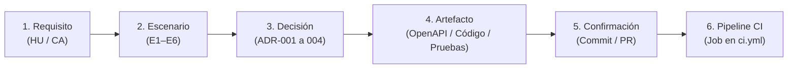

# 🔗 Matriz de Trazabilidad Integral Punta a Punta (Semana 4)

| Metadato | Detalle |
|---|---|
| **Proyecto** | Nexora · Sistema web de orientación vocacional |
| **Módulo** | Automatización de Procesos de Software |
| **Programa** | Maestría en Ingeniería en Software · UPEC |
| **Criterio de Evaluación** | Rúbrica Semana 4 · Criterio 1: Coherencia y trazabilidad punta a punta (Ponderación: 25 %) |
| **Cadena Formal Exigida** | $\text{Requisito} \longrightarrow \text{Escenario} \longrightarrow \text{ADR} \longrightarrow \text{Artefacto} \longrightarrow \text{Commit / PR} \longrightarrow \text{Pipeline}$ |

---

## 1. Cadena de Trazabilidad Exigida por la Rúbrica

En estricto apego a la norma **ISO/IEC/IEEE 29148:2018**, cada funcionalidad del sistema se rastrea de punta a punta a lo largo del ciclo de vida del software:

---

## 2. Matriz de Trazabilidad Punta a Punta

| Requisito (HU y CA) | Escenario de Calidad | Decisión de Arquitectura | Artefacto (Contrato, Código y Pruebas) | Commit o PR en GitHub | Job en Pipeline CI (`ci.yml`) |
|---|---|---|---|---|---|
| **HU-01: Autenticación de Estudiantes** • **CA-01.1:** Login válido emite Bearer JWT (120 min). • **CA-01.2:** 100 credenciales erróneas rechazadas con HTTP 401. | **E1: Rendimiento y seguridad en login** (P95 < 500 ms, hash seguro Argon2id). | [**ADR-001**](03-adr/ADR-001-control-de-acceso.md) (Control de acceso JWT y Argon2id)  [**ADR-003**](03-adr/ADR-003-estilo-arquitectonico.md) (Monolito modular con capas) | • Contrato: [`api/openapi.yaml`](../api/openapi.yaml) (`POST /api/v1/auth/login`) • Código: [`src/api/v1/auth.py`](../src/api/v1/auth.py), [`backend/app/modules/cuentas/`](../backend/app/modules/cuentas/) • Pruebas: [`tests/test_auth.py`](../tests/test_auth.py) (8 pruebas) | [PR #2](https://github.com/enriqueherreraec/nexora-arquitectura/pull/2) Commit [`c72e5ca`](https://github.com/enriqueherreraec/nexora-arquitectura/commit/c72e5ca)  [PR #14](https://github.com/enriqueherreraec/nexora-arquitectura/pull/14) Commit [`2e3304e`](https://github.com/enriqueherreraec/nexora-arquitectura/commit/2e3304e) | • `ci-lint-and-static-analysis` (Flake8, Bandit) • `ci-tests` (Pytest + PostgreSQL) • `ci-docs-and-frontend` (Vite) |
| **HU-02: Registro de Evaluación Vocacional** • **CA-02.1:** 20 respuestas Likert (0–4) persisten atómicamente y calculan 10 áreas (HTTP 201). • **CA-02.2:** Fallo inducido revierte transacción limpiamente sin persistencia parcial. | **E2: Integridad transaccional de evaluaciones** (Rollback real ante fallos en PostgreSQL). | [**ADR-002**](03-adr/ADR-002.md) (Integridad transaccional e inmutabilidad)  [**ADR-003**](03-adr/ADR-003-estilo-arquitectonico.md) (Monolito modular con capas) | • Contrato: [`api/openapi.yaml`](../api/openapi.yaml) (`POST /api/v1/evaluaciones`) • Código: [`src/services/evaluacion_service.py`](../src/services/evaluacion_service.py), [`backend/app/modules/evaluaciones/`](../backend/app/modules/evaluaciones/) • Pruebas: [`tests/test_evaluaciones.py`](../tests/test_evaluaciones.py) (11 pruebas; prueba de rollback con 30 fallos inducidos) | [PR #4](https://github.com/enriqueherreraec/nexora-arquitectura/pull/4) Commit [`a2c7d77`](https://github.com/enriqueherreraec/nexora-arquitectura/commit/a2c7d77)  [PR #14](https://github.com/enriqueherreraec/nexora-arquitectura/pull/14) Commit [`2e3304e`](https://github.com/enriqueherreraec/nexora-arquitectura/commit/2e3304e) | • `ci-lint-and-static-analysis` (Spectral CLI) • `ci-tests` (Pytest + PostgreSQL) • `ci-docs-and-frontend` (Vite) |
| **HU-03: Consulta de Histórico Propio** • **CA-03.1:** Consulta de última evaluación propia retorna HTTP 200 y perfil calculado. • **CA-03.2:** Aislamiento estricto entre cuentas: rechaza acceso a datos de terceros (HTTP 401/404). | **E3: Aislamiento de recursos y concurrencia** (Control estricto de propiedad de datos). | [**ADR-001**](03-adr/ADR-001-control-de-acceso.md) (Aislamiento por token JWT)  [**ADR-003**](03-adr/ADR-003-estilo-arquitectonico.md) (Monolito modular) | • Contrato: [`api/openapi.yaml`](../api/openapi.yaml) (`GET /api/v1/evaluaciones/ultima`) • Código: [`src/api/v1/evaluaciones.py`](../src/api/v1/evaluaciones.py), [`backend/app/modules/evaluaciones/`](../backend/app/modules/evaluaciones/) • Pruebas: [`tests/test_evaluaciones.py`](../tests/test_evaluaciones.py) (CA-03.1 y CA-03.2) | [PR #6](https://github.com/enriqueherreraec/nexora-arquitectura/pull/6) Commit [`d89409d`](https://github.com/enriqueherreraec/nexora-arquitectura/commit/d89409d)  [PR #14](https://github.com/enriqueherreraec/nexora-arquitectura/pull/14) Commit [`2e3304e`](https://github.com/enriqueherreraec/nexora-arquitectura/commit/2e3304e) | • `ci-lint-and-static-analysis` (Spectral CLI) • `ci-tests` (Pytest + PostgreSQL) • `ci-docs-and-frontend` (Redocly) |
| **HU-04: Informe PDF y Envío por Correo** • **CA-04.1:** Generación en memoria de PDF formal con ReportLab. • **CA-04.2:** Resiliencia SMTP: caída o timeout del servidor retorna HTTP 503 controlado sin crash. | **E5: Resiliencia ante fallos externos SMTP** (Manejo de excepciones y fallback controlado).  **E6: Generación eficiente de informes** (Procesamiento en memoria `io.BytesIO`). | [**ADR-003**](03-adr/ADR-003-estilo-arquitectonico.md) (Monolito modular con capas)  [**ADR-001**](03-adr/ADR-001-control-de-acceso.md) (Protección de informe por usuario) | • Contrato: [`api/openapi.yaml`](../api/openapi.yaml) (`POST /api/v1/informes/{id}/enviar-correo`) • Código: [`src/services/pdf_service.py`](../src/services/pdf_service.py), [`src/services/email_service.py`](../src/services/email_service.py), [`backend/app/modules/informes/`](../backend/app/modules/informes/) • Pruebas: [`tests/test_informes.py`](../tests/test_informes.py) (8 pruebas) | [PR #8](https://github.com/enriqueherreraec/nexora-arquitectura/pull/8) Commit [`fe08a5d`](https://github.com/enriqueherreraec/nexora-arquitectura/commit/fe08a5d)  [PR #14](https://github.com/enriqueherreraec/nexora-arquitectura/pull/14) Commit [`2e3304e`](https://github.com/enriqueherreraec/nexora-arquitectura/commit/2e3304e) | • `ci-lint-and-static-analysis` (Flake8, Bandit) • `ci-tests` (Pytest + PostgreSQL) • `ci-docs-and-frontend` (Vite) |
| **Gobernanza y Control de Versiones** • Adopción de GitHub Flow. • Protección de `main` con revisión obligatoria. • Resolución documentada de conflicto. | **E4: Disponibilidad del catálogo y gobernanza** (Trazabilidad inmutable de cambios). | [**ADR-004**](03-adr/ADR-004-control-de-versiones.md) (Selección de Git, GitHub y GitHub Flow) | • Reglas: [`CONTRIBUTING.md`](../CONTRIBUTING.md) • Plantillas: [`.github/ISSUE_TEMPLATE/tarea.md`](../.github/ISSUE_TEMPLATE/tarea.md), [`.github/pull_request_template.md`](../.github/pull_request_template.md) • Conflicto: [`docs/10-conflicto-integracion.md`](10-conflicto-integracion.md) | [PR #10](https://github.com/enriqueherreraec/nexora-arquitectura/pull/10) Commit [`aa6d3ae`](https://github.com/enriqueherreraec/nexora-arquitectura/commit/aa6d3ae)  [PR #12](https://github.com/enriqueherreraec/nexora-arquitectura/pull/12) Commit [`0e6ca50`](https://github.com/enriqueherreraec/nexora-arquitectura/commit/0e6ca509a19aa3328ae9bd4fef313b4a61412fcb) | • Ruleset de GitHub (revisión aprobada obligatoria) • `ci-lint-and-static-analysis` |
| **Compuerta de Calidad y Falla Controlada** • Verificación estricta de Flake8, Bandit y Spectral. • Bloqueo ante fallo inducido y posterior subsanación atómica. | **E4: Calidad y gobernanza del código** (Cero tolerancia a regresiones de formato o especificación). | [**ADR-004**](03-adr/ADR-004-control-de-versiones.md) (Control de versiones y compuertas automáticas) | • Workflow: [`.github/workflows/ci.yml`](../.github/workflows/ci.yml) • Código: [`src/api/v1/auth.py`](../src/api/v1/auth.py) • Reporte: [`evidencias/semana4/falla-controlada.md`](../evidencias/semana4/falla-controlada.md) | [PR #15](https://github.com/enriqueherreraec/nexora-arquitectura/pull/15) Commit fallo: [`9177399`](https://github.com/enriqueherreraec/nexora-arquitectura/commit/917739981c84727d8033451aae88e0259f0bfd6b) Commit fix: [`d9a5d5b`](https://github.com/enriqueherreraec/nexora-arquitectura/commit/d9a5d5bf6e67f1a3362082017b5b2836e3abda01) | • `ci-lint-and-static-analysis` • Fallo: [Run 42148320773](https://github.com/enriqueherreraec/nexora-arquitectura/actions/runs/42148320773) • Subsanación: [Run 42148477568](https://github.com/enriqueherreraec/nexora-arquitectura/actions/runs/42148477568) |
| **Monitoreo de Infraestructura y Humo** • Diagnóstico en vivo de API y base de datos. • Comprobación de versión y commit desplegado. | **E1 / E4: Disponibilidad y observabilidad** (Inspección del estado sin exponer secretos). | [**ADR-003**](03-adr/ADR-003-estilo-arquitectonico.md) (Monolito modular con capas) | • Código: [`backend/app/api/v1/health.py`](../backend/app/api/v1/health.py), [`backend/app/main.py`](../backend/app/main.py) (`GET /salud`) • Enlace en vivo: [`https://nexora-backend-ndp1.onrender.com/salud`](https://nexora-backend-ndp1.onrender.com/salud) • Frontend: [`frontend/src/components/TechnicalDiagnostics.tsx`](../frontend/src/components/TechnicalDiagnostics.tsx) • Prueba de humo: Script curl en pipeline | [PR #14](https://github.com/enriqueherreraec/nexora-arquitectura/pull/14) Commit [`2e3304e`](https://github.com/enriqueherreraec/nexora-arquitectura/commit/2e3304e) | • `cd-deploy` (Sondeo activo contra `/salud` validando hash de commit real) |

---

## 3. Verificación de Consistencia de Identificadores

1. **Requisitos e Historias:** `HU-01`, `HU-02`, `HU-03`, `HU-04` y sus criterios asociados (`CA-01.1` a `CA-04.2`) coinciden exactamente con la especificación de [`docs/07-historias-y-criterios.md`](07-historias-y-criterios.md).
2. **Escenarios de Calidad:** `E1`, `E2`, `E3`, `E4`, `E5`, `E6` coinciden con los escenarios descritos en [`docs/01-contexto-y-drivers/contexto-y-drivers.md`](01-contexto-y-drivers/contexto-y-drivers.md).
3. **Decisiones de Arquitectura:** `ADR-001`, `ADR-002`, `ADR-003`, `ADR-004` corresponden a los registros formales archivados en [`docs/03-adr/`](03-adr/).
4. **Pipeline:** Todos los nombres de jobs (`ci-lint-and-static-analysis`, `ci-tests`, `ci-docs-and-frontend`, `cd-deploy`) corresponden exactamente a la definición de [`.github/workflows/ci.yml`](../.github/workflows/ci.yml).
