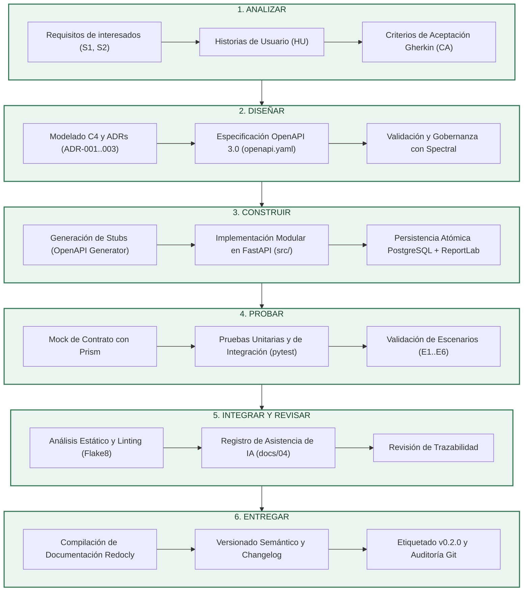

# Mapa de Toolchain y Cadena CASE de Nexora

## 1. Alcance de la cadena CASE para Nexora

El proyecto Nexora es un sistema web de orientación vocacional enfocado en apoyar a estudiantes preuniversitarios mediante el registro de cuestionarios vocacionales, la determinación de áreas predominantes, la recomendación de carreras y universidades públicas del Ecuador y la generación y despacho de informes oficiales en PDF por correo electrónico.

La cadena CASE (Computer-Aided Software Engineering) tiene como alcance automatizar, controlar y asegurar la trazabilidad del ciclo de vida del backend modular de Nexora sobre las cuatro operaciones fundamentales analizadas:
- `POST /api/v1/auth/login`: Autenticación y emisión de tokens JWT.
- `POST /api/v1/evaluaciones`: Registro transaccional atómico de 20 respuestas Likert y cálculo vocacional de 10 áreas.
- `GET /api/v1/evaluaciones/ultima`: Consulta de la última evaluación garantizando aislamiento de propiedad.
- `POST /api/v1/informes/{id}/enviar-correo`: Generación de informe PDF y despacho vía SMTP con tolerancia a fallos.

La cadena integra herramientas desde el análisis y diseño arquitectónico hasta la integración continua y entrega, asegurando que las decisiones documentadas en los ADR y los escenarios de calidad (E1 a E6) se cumplan de manera verificable y reproducible.

---

## 2. Proceso por fases: artefactos y responsables

| Fase | Objetivo de la fase | Artefactos generados | Responsables |
|---|---|---|---|
| **Analizar** | Capturar necesidades de interesados, estructurar historias de usuario y definir criterios de aceptación verificables. | Historias de Usuario (`docs/07-historias-y-criterios.md`), Matriz de Trazabilidad, Drivers de calidad. | Analista de Requisitos / Arquitecto de Software |
| **Diseñar** | Modelar vistas estructurales C4, formalizar decisiones en ADR y especificar el contrato de interfaz API REST. | Vistas C4 (`docs/02-vistas-c4/`), ADRs (`docs/03-adr/`), Contrato OpenAPI (`api/openapi.yaml`), Reglas Spectral (`.spectral.yaml`). | Arquitecto de Software / Diseñador de API |
| **Construir** | Generar stubs de código e implementar la lógica de negocio modular, persistencia relacional y generación de PDF. | Stubs (`generated/server/`), Código fuente (`src/`), Modelos ORM, Migraciones de base de datos. | Desarrollador Backend |
| **Probar** | Simular respuestas del contrato y ejecutar pruebas automáticas unitarias, de integración y de inyección de fallos. | Mock de Prism, Pruebas automatizadas (`tests/`), Reportes de cobertura, Evidencias de pruebas. | Ingeniero de Pruebas (QA) / Desarrollador |
| **Integrar y revisar** | Verificar la calidad estática del código, formateo, ausencia de vulnerabilidades y revisión cruzada de cambios. | Reporte de Linter (Flake8), Registro de IA (`docs/04-registro-ia.md`), Bitácora de revisión cruzada. | Ingeniero DevOps / Revisor Técnico |
| **Entregar** | Versionar semánticamente el release, documentar cambios y generar paquetes de distribución reproducibles. | Changelog (`CHANGELOG.md`), Documentación API (`docs/api/index.html`), Tag Git (`v0.2.0`). | Líder Técnico / Release Manager |

---

## 3. Diagrama del proceso en Mermaid



---

## 4. Diez tareas concretas de la cadena CASE para Nexora (T1 a T10)

Las siguientes 10 tareas están contextualizadas estrictamente en el dominio vocacional y arquitectónico de Nexora:

1. **T1:** Especificación de historias de usuario y criterios de aceptación en Gherkin para el cuestionario vocacional de 20 preguntas y el despacho de informes.
2. **T2:** Mapeo y actualización de la matriz de trazabilidad entre requisitos (HU), drivers (D1–D5), escenarios (E1–E6) y decisiones ADR.
3. **T3:** Modelado visual en texto de las vistas arquitectónicas C4 (contexto y contenedores) y diagramas de flujo de transacciones.
4. **T4:** Especificación formal, gobernanza y validación de esquemas del contrato OpenAPI 3.0 para las cuatro rutas del alcance.
5. **T5:** Generación automatizada de stubs y modelos Pydantic de servidor en FastAPI a partir del contrato de interfaz.
6. **T6:** Asistencia inteligente para el diseño e implementación del algoritmo de cálculo vocacional (10 áreas, resolución de empates y detección de ceros).
7. **T7:** Simulación desacoplada (mocking) de las respuestas del API y validación de peticiones de la aplicación web cliente.
8. **T8:** Ejecución automatizada de pruebas unitarias y de integración transaccional en PostgreSQL (atomicidad E2 y control de acceso ADR-001).
9. **T9:** Análisis estático de código, verificación de estándares PEP8 y detección de errores de sintaxis mediante linter.
10. **T10:** Compilación de documentación técnica interactiva, versionado semántico y actualización del registro de cambios (Changelog).

---

## 5. Priorización de tareas: Escalas y justificación

### Escala de valoración (1 a 5)

| Nivel | Frecuencia (F) | Esfuerzo manual (E) | Riesgo de defecto (R) |
|:---:|---|---|---|
| **1** | Rara vez (una vez por proyecto) | Mínimo (< 15 minutos) | Despreciable (impacto cosmético) |
| **2** | Ocasional (cada hito o versión mayor) | Bajo (15 a 45 minutos) | Menor (inconveniente local corregible) |
| **3** | Periódica (en cada sprint o ciclo de desarrollo) | Moderado (1 a 3 horas) | Moderado (falla funcional no crítica) |
| **4** | Frecuente (varias veces por semana o en cada cambio de API) | Alto (3 a 8 horas) | Alto (inconsistencia de datos o brecha de seguridad) |
| **5** | Muy frecuente (múltiples veces al día, con cada commit) | Muy alto (> 8 horas o altamente tedioso y repetitivo) | Crítico (pérdida de datos, caída del sistema, daño de integridad) |

### Fórmula de puntuación
$$\text{Puntaje} = \text{Frecuencia (F)} \times \text{Esfuerzo manual (E)} \times \text{Riesgo (R)}$$

### Justificación de valores para cada tarea

| ID | Tarea | F | E | R | Puntaje | Justificación detallada de los valores |
|---|---|:---:|:---:|:---:|:---:|---|
| **T1** | Especificación de historias y criterios Gherkin | 3 | 3 | 3 | **27** | **F (3):** Ocurre al inicio de iteraciones y ajustes de alcance. <br>**E (3):** Redactar criterios precisos en Gherkin requiere análisis cuidadoso. <br>**R (3):** Una historia ambigua causa desvíos en la implementación. |
| **T2** | Matriz de trazabilidad requisitos-arquitectura | 2 | 3 | 3 | **18** | **F (2):** Se actualiza principalmente en hitos de entrega o auditorías. <br>**E (3):** Cruzar manualmente drivers, escenarios y endpoints es minucioso. <br>**R (3):** La pérdida de trazabilidad dificulta auditar requisitos no funcionales. |
| **T3** | Modelado C4 y diagramas de arquitectura | 2 | 3 | 3 | **18** | **F (2):** Cambios de arquitectura ocurren ocasionalmente tras decisiones ADR. <br>**E (3):** Diseñar diagramas claros toma tiempo moderado. <br>**R (3):** Diagramas obsoletos desalinean a los equipos pero no rompen código directamente. |
| **T4** | Validación y gobernanza de contrato OpenAPI | 4 | 4 | 5 | **80** | **F (4):** El contrato se revisa ante cualquier adición o cambio de campos en las 4 rutas. <br>**E (4):** Validar manualmente cientos de líneas de esquema YAML y reglas semánticas es muy laborioso. <br>**R (5):** Un contrato inválido o discrepante rompe la integración frontend/backend y los clientes externos. |
| **T5** | Generación automatizada de stubs de servidor | 2 | 4 | 4 | **32** | **F (2):** Se regenera cuando cambia la especificación del contrato. <br>**E (4):** Escribir manualmente todos los routers y DTOs Pydantic consume varias horas. <br>**R (4):** Errores tipográficos manuales en DTOs generan fallas en runtime. |
| **T6** | Asistencia de IA para lógica vocacional y reglas | 3 | 4 | 5 | **60** | **F (3):** Se ajusta cuando se calibran ponderaciones, áreas y desempates pedagógicos. <br>**E (4):** Diseñar algoritmos multicriterio de afinidad sin asistencia requiere alto esfuerzo analítico. <br>**R (5):** Errores en la lógica vocacional entregan recomendaciones erradas a estudiantes preuniversitarios. |
| **T7** | Simulación Mock del API para pruebas desacopladas | 4 | 4 | 4 | **64** | **F (4):** Muy frecuente para habilitar desarrollo concurrente del cliente web. <br>**E (4):** Crear servidores mock simulados manualmente para cada código HTTP es costoso. <br>**R (4):** Un mock desalineado del contrato introduce falsas expectativas de integración. |
| **T8** | Pruebas unitarias y transaccionales en PostgreSQL | 4 | 3 | 4 | **48** | **F (4):** Se ejecutan en cada cambio de código del backend. <br>**E (3):** Ejecutar pruebas manuales de base de datos e inyección de fallos es lento. <br>**R (4):** Falla en atomicidad (E2) o control de acceso (ADR-001) corrompe datos persistentes. |
| **T9** | Análisis estático y linter de código (Flake8) | 5 | 2 | 3 | **30** | **F (5):** Se ejecuta con cada guardado de archivo o commit. <br>**E (2):** La revisión visual de estilo es tediosa pero mecanizable. <br>**R (3):** Errores de estilo no detienen la ejecución, pero importaciones no usadas o variables indefinidas sí causan bugs. |
| **T10** | Documentación Redocly, versionado y Changelog | 2 | 2 | 3 | **12** | **F (2):** Ocurre al finalizar el release para empaquetado. <br>**E (2):** Compilar documentación con herramientas modernas es rápido. <br>**R (3):** Una versión mal etiquetada genera confusión en despliegue. |

---

## 6. Clasificación de tareas por puntaje

| Puesto | Identificador | Tarea de la cadena CASE | F | E | R | Puntaje total | Categoría prioritaria |
|:---:|:---:|---|:---:|:---:|:---:|:---:|:---:|
| **1.** | **T4** | Validación y gobernanza de contrato OpenAPI | 4 | 4 | 5 | **80** | **Prioritaria (Top 1)** |
| **2.** | **T7** | Simulación Mock del API con Prism | 4 | 4 | 4 | **64** | **Prioritaria (Top 2)** |
| **3.** | **T6** | Asistencia de IA para lógica vocacional y reglas | 3 | 4 | 5 | **60** | **Prioritaria (Top 3)** |
| 4. | **T8** | Pruebas unitarias y transaccionales en PostgreSQL | 4 | 3 | 4 | **48** | Media |
| 5. | **T5** | Generación de stubs con OpenAPI Generator | 2 | 4 | 4 | **32** | Media |
| 6. | **T9** | Análisis estático de código y linter | 5 | 2 | 3 | **30** | Media |
| 7. | **T1** | Especificación de historias y criterios Gherkin | 3 | 3 | 3 | **27** | Normal |
| 8. | **T2** | Matriz de trazabilidad requisitos-arquitectura | 2 | 3 | 3 | **18** | Normal |
| 9. | **T3** | Modelado C4 y diagramas con Mermaid | 2 | 3 | 3 | **18** | Normal |
| 10. | **T10** | Documentación Redocly y versionado semántico | 2 | 2 | 3 | **12** | Normal |

---

## 7. Herramientas candidatas por fase y clasificación CASE

| Fase | Tarea asociada | Herramienta seleccionada | Clasificación CASE | Justificación técnica de la selección |
|---|---|---|---|---|
| **Analizar** | T1, T2 | **Markdown + Gherkin** | Upper CASE | Permite redactar historias de usuario y especificaciones ejecutables bajo control de versiones Git sin dependencias propietarias. |
| **Diseñar** | T3 | **Mermaid CLI / Diagrams** | Upper CASE | Permite renderizar diagramas C4 y de secuencia directamente a partir de texto版本ado en el repositorio. |
| **Diseñar** | T4 | **Spectral CLI** | Lower CASE | Motor de linter de contratos OpenAPI líder en la industria, flexible para aplicar reglas estrictas de esquemas y metadatos. |
| **Construir** | T5 | **OpenAPI Generator CLI** | Lower CASE | Generador maduro y ampliamente adoptado para producir andamiajes de servidor FastAPI y modelos tipados Pydantic. |
| **Construir** | T6 | **Antigravity AI Assistant (Google DeepMind)** | I-CASE | Asistente inteligente integrado en el IDE con razonamiento avanzado para lógica de negocio, algoritmos de cálculo y pruebas. |
| **Probar** | T7 | **Stoplight Prism CLI** | Lower CASE | Servidor mock HTTP de alto rendimiento que valida solicitudes y emula respuestas apegadas 100 % al contrato OpenAPI. |
| **Probar** | T8 | **Pytest + SQLAlchemy** | Lower CASE | Marco estándar para pruebas en Python con soporte de transacciones aisladas sobre PostgreSQL real. |
| **Integrar y revisar** | T9 | **Flake8 / Ruff** | Lower CASE | Linters estáticos de análisis sintáctico que detectan violaciones PEP8, variables no utilizadas y errores de importación. |
| **Entregar** | T10 | **Redocly CLI + Git** | Lower CASE | Compila documentación estática responsive de OpenAPI sin servidor activo y asegura trazabilidad mediante tags SHA inmutables. |

---

## 8. Pruebas reales de las tres tareas prioritarias

### Prueba 1: T4 – Validación de contrato con Spectral CLI
- **Tarea y herramienta:** Tarea T4. Spectral CLI (`@stoplight/spectral-cli` versión 6.17.0 sobre Node.js v24.15.0).
- **Categoría CASE:** Lower CASE (Verificación y gobernanza de especificaciones).
- **Objetivo:** Comprobar la validez sintáctica y semántica del archivo de contrato `api/openapi.yaml` contra el conjunto de reglas estándar OAS y reglas de proyecto en `.spectral.yaml`.
- **Entrada utilizada:** Archivo de especificación OpenAPI 3.0.3 [`api/openapi.yaml`](../../api/openapi.yaml) y configuración [`.spectral.yaml`](../../.spectral.yaml).
- **Procedimiento y comandos:**
  ```bash
  npx -y @stoplight/spectral-cli lint api/openapi.yaml --ruleset .spectral.yaml
  ```
- **Resultado esperado:** Cero errores de severidad *error*. Cumplimiento de descripciones, identificadores de operación, esquemas de seguridad y ejemplos de datos válidos.
- **Resultado observado:** Inicialmente se detectó un warning por trailing slash en `/api/v1/evaluaciones/` y un error en el ejemplo de `GET /api/v1/evaluaciones/ultima` al que le faltaba la propiedad requerida `todas_cero`. Tras la corrección, la salida arrojó:
  ```text
  No results with a severity of 'error' found!
  ```
- **Defectos detectados y correcciones:** Se eliminó la barra final en la ruta según la recomendación OpenAPI (`path-keys-no-trailing-slash`) y se agregó `todas_cero: false` al ejemplo del esquema.
- **Decisión:** Aprobado satisfactoriamente.
- **Enlace relativo a evidencia:** [t4-spectral-output.txt](../evidencias/herramientas/t4-spectral-output.txt) y [spectral-validation.txt](../evidencias/contrato/spectral-validation.txt).

---

### Prueba 2: T7 – Simulación Mock con Stoplight Prism CLI
- **Tarea y herramienta:** Tarea T7. Stoplight Prism CLI (`@stoplight/prism-cli` versión 5.15.11).
- **Categoría CASE:** Lower CASE (Simulación y desacoplamiento de API).
- **Objetivo:** Levantar un servidor mock local que reciba solicitudes HTTP reales en las cuatro rutas del alcance, valide las cargas útiles y retorne respuestas acordes a los esquemas.
- **Entrada utilizada:** Contrato OpenAPI [`api/openapi.yaml`](../../api/openapi.yaml) servido en `http://127.0.0.1:4010`.
- **Procedimiento y comandos:**
  ```bash
  # 1. Iniciar mock en segundo plano
  npx -y @stoplight/prism-cli mock api/openapi.yaml -p 4010 -h 127.0.0.1

  # 2. Enviar solicitudes reales con Invoke-RestMethod (PowerShell) a los 4 endpoints
  POST http://127.0.0.1:4010/api/v1/auth/login
  POST http://127.0.0.1:4010/api/v1/evaluaciones
  GET  http://127.0.0.1:4010/api/v1/evaluaciones/ultima
  POST http://127.0.0.1:4010/api/v1/informes/501/enviar-correo
  ```
- **Resultado esperado:** Prism negocia los encabezados `Content-Type: application/json`, valida el payload y responde con los códigos definidos en el contrato: 200, 201, 200 y 200.
- **Resultado observado:** Prism procesó las 4 solicitudes concurrentes, validó que los cuerpos cumplían con los esquemas requeridos y retornó los códigos HTTP correspondientes con los datos de ejemplo del contrato.
- **Defectos detectados y correcciones:** Ninguno en tiempo de ejecución. Prism confirmó que el contrato es completamente consumible.
- **Decisión:** Aprobado satisfactoriamente.
- **Enlace relativo a evidencia:** [t7-prism-mock-output.txt](../evidencias/herramientas/t7-prism-mock-output.txt) y [mock-server-execution.log](../evidencias/contrato/mock-server-execution.log).

---

### Prueba 3: T6 – Asistencia de IA en Lógica Vocacional (Antigravity AI Assistant)
- **Tarea y herramienta:** Tarea T6. Antigravity AI Assistant (Google DeepMind).
- **Tipo y acceso:** Servicio de inteligencia artificial integrado en el IDE de desarrollo, operando mediante modelos fundacionales sobre el entorno de trabajo del usuario.
- **Categoría CASE:** I-CASE (Entorno asistido por IA para diseño, codificación y pruebas).
- **Objetivo:** Generar y refinar la lógica de evaluación vocacional de Nexora para procesar las 20 respuestas Likert, clasificar en 10 áreas, manejar empates sin sesgos arbitrarios y preservar la inmutabilidad histórica (ADR-002).
- **Entrada utilizada:** Especificación matemática del baremo de Nexora (preguntas pares/impares asociadas a 10 áreas temáticas, escala 0 a 4 puntos por pregunta, puntaje máximo 8 puntos por área) y requerimientos de reversión de fallos.
- **Procedimiento y prompt resumido:** Se solicitó generar la función determinista en Python para calcular afinidades vocacionales, recomendaciones pedagógicas y control del caso de desinterés (`todas_cero`).
- **Resultado esperado:** Código Python tipado, desacoplado de la capa de persistencia, con funciones puras verificables mediante pruebas unitarias.
- **Resultado observado:** La IA generó la estructura de funciones base, pero omitió el metadato de control de versión inmutable del cuestionario y seleccionaba aleatoriamente la primera área en caso de empate múltiple.
- **Defectos detectados y correcciones:** Se identificó que la solución inicial sesgaba la orientación ante empates. Se corrigió solicitando la inclusión de `areas_empatadas: List[str]`, `es_empate: bool`, y la constante inmutable `version_cuestionario = "3.0-20preguntas"`.
- **Decisión:** Modificado y aceptado tras verificación formal.
- **Enlace relativo a evidencia:** [t6-ia-assistance.md](../evidencias/herramientas/t6-ia-assistance.md).
