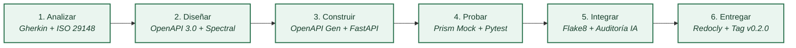

# Informe Técnico: Cadena de Herramientas CASE y Validación del Sistema Nexora

## Resumen Ejecutivo

Este informe consolida el diseño, implementación y verificación de la cadena de herramientas CASE (*Computer-Aided Software Engineering*) para el sistema web de orientación vocacional Nexora. El trabajo abarca desde la especificación formal de requisitos bajo la norma ISO/IEC/IEEE 29148 hasta la construcción de un servicio ejecutable en FastAPI con persistencia atómica en PostgreSQL 18.4, generación de informes en PDF con ReportLab y despacho controlado por correo electrónico. Se formalizaron diez tareas del ciclo de desarrollo, se priorizaron las tres herramientas de mayor criticidad (Spectral CLI, Stoplight Prism CLI y Antigravity AI Assistant), se validó el contrato OpenAPI con cero errores y se ejecutó una suite de 16 pruebas automatizadas que alcanzó el 91 % de cobertura de código. El análisis de escenarios de calidad distingue de forma transparente entre verificaciones funcionales ejecutadas y pruebas de carga o usabilidad pendientes.

---

## 1. Introducción y Objetivo

### 1.1. Contexto del proyecto
Nexora orienta a estudiantes de bachillerato y preuniversitarios en la exploración de su vocación profesional mediante un cuestionario de 20 preguntas en escala Likert. El sistema calcula afinidades en 10 áreas del conocimiento, recomienda carreras de universidades públicas del Ecuador considerando pertinencia y ubicación geográfica, y despacha un informe formal en PDF por correo electrónico.

### 1.2. Objetivo general
Diseñar, implementar y evaluar una cadena de herramientas CASE integrada que asegure la trazabilidad, gobernanza y calidad del software en las cuatro operaciones fundamentales del backend de Nexora, sustentada en estándares internacionales y verificaciones empíricas reproducibles.

---

## 2. Alcance Arquitectónico

El alcance comprende las cuatro operaciones acordadas en el dossier de arquitectura:

| ID | Método | Endpoint | Responsabilidad funcional | Drivers asociados |
|---|---|---|---|---|
| **EP1** | `POST` | `/api/v1/auth/login` | Autenticación y emisión de token JWT Bearer. | D1 (Seguridad), D5 (Continuidad). |
| **EP2** | `POST` | `/api/v1/evaluaciones` | Registro atómico de respuestas Likert y cálculo de 10 áreas vocacionales. | D2 (Integridad), D4 (Mantenibilidad). |
| **EP3** | `GET` | `/api/v1/evaluaciones/ultima` | Consulta aislada del último diagnóstico del estudiante autenticado. | D1 (Seguridad), D3 (Desempeño). |
| **EP4** | `POST` | `/api/v1/informes/{id}/enviar-correo` | Generación de informe PDF y despacho por correo electrónico. | D1 (Propiedad), D5 (Tolerancia SMTP). |

---

## 3. Proceso de Desarrollo y Mapa de Toolchain

El ciclo de desarrollo se estructura en seis fases secuenciales e iterativas:



### Artefactos y roles por fase

| Fase | Objetivo principal | Artefactos generados | Responsable |
|---|---|---|---|
| **Analizar** | Estructurar necesidades en historias y criterios ejecutables. | Historias de Usuario, Criterios Gherkin (`docs/07-historias-y-criterios.md`). | Analista de Requisitos |
| **Diseñar** | Modelar interfaces, contratos y salvaguardas arquitectónicas. | Contrato OpenAPI (`api/openapi.yaml`), Configuración Spectral (`.spectral.yaml`). | Arquitecto de Software |
| **Construir** | Generar andamiajes e implementar la lógica de negocio y persistencia. | Stubs (`generated/server/`), Código fuente (`src/`). | Desarrollador Backend |
| **Probar** | Validar la integración del cliente y verificar invariantes de calidad. | Mock Prism, Suite de pruebas (`tests/`), Resultados de pruebas. | Ingeniero de Calidad (QA) |
| **Integrar** | Analizar estilo, detectar defectos sintácticos y auditar cambios de IA. | Reporte de linter, Bitácora de IA (`docs/04-registro-ia.md`). | Revisor de Código |
| **Entregar** | Compilar documentación interactiva y versionar el release. | Documentación (`docs/api/index.html`), Changelog (`CHANGELOG.md`). | Release Manager |

---

## 4. Diez Tareas de la Cadena y Priorización Cuantitativa

Se definieron diez tareas adaptadas al dominio vocacional de Nexora, evaluadas mediante la fórmula de criticidad:
$$\text{Puntaje} = \text{Frecuencia (F)} \times \text{Esfuerzo Manual (E)} \times \text{Riesgo (R)}$$

| ID | Tarea concreta | F | E | R | Puntaje | Clasificación | Herramienta asignada |
|---|---|:---:|:---:|:---:|:---:|:---:|---|
| **T4** | Validación y gobernanza de contrato OpenAPI | 4 | 4 | 5 | **80** | **Prioritaria 1** | Spectral CLI |
| **T7** | Simulación Mock del API para pruebas desacopladas | 4 | 4 | 4 | **64** | **Prioritaria 2** | Stoplight Prism CLI |
| **T6** | Asistencia de IA para lógica vocacional y desempates | 3 | 4 | 5 | **60** | **Prioritaria 3** | Antigravity AI Assistant |
| **T8** | Pruebas unitarias y transaccionales en PostgreSQL | 4 | 3 | 4 | **48** | Media | Pytest + SQLAlchemy |
| **T5** | Generación de stubs de servidor con OpenAPI Generator | 2 | 4 | 4 | **32** | Media | OpenAPI Generator CLI |
| **T9** | Análisis estático y verificación de estilo de código | 5 | 2 | 3 | **30** | Media | Flake8 |
| **T1** | Especificación de historias y criterios en Gherkin | 3 | 3 | 3 | **27** | Normal | Markdown / Gherkin |
| **T2** | Mantenimiento de matriz de trazabilidad bidireccional | 2 | 3 | 3 | **18** | Normal | Markdown |
| **T3** | Modelado visual C4 de contexto y contenedores | 2 | 3 | 3 | **18** | Normal | Mermaid CLI |
| **T10** | Compilación de documentación y versionado semántico | 2 | 2 | 3 | **12** | Normal | Redocly CLI + Git |

Las tres herramientas de mayor puntaje matemático son:
1. **Spectral CLI (T4 - 80 pts):** Controla el riesgo de desalineación sintáctica antes de codificar.
2. **Stoplight Prism CLI (T7 - 64 pts):** Reduce el esfuerzo de emular manualmente el contrato para el frontend.
3. **Antigravity AI Assistant (T6 - 60 pts):** Mitiga el riesgo de diseñar algoritmos vocacionales con sesgos o desempates inconsistentes.

---

## 5. Pruebas Reales de Herramientas Prioritarias

### 5.1. Tarea T4: Spectral CLI (v6.17.0 sobre Node.js v24.15.0)
- **Objetivo:** Auditar la conformidad del contrato `api/openapi.yaml` contra reglas OAS y directrices de calidad.
- **Entrada:** Contrato YAML de 709 líneas y configuración `.spectral.yaml`.
- **Comando:** `npx -y @stoplight/spectral-cli lint api/openapi.yaml --ruleset .spectral.yaml`
- **Resultado:** Detectó inicialmente un warning de barra final en `/api/v1/evaluaciones/` y un error de esquema por omisión de `todas_cero` en el ejemplo de respuesta 200 de la última evaluación. Corregidos ambos puntos, arrojó:
  ```text
  No results with a severity of 'error' found!
  ```
- **Evidencia:** [`evidencias/contrato/spectral-validation.txt`](../evidencias/contrato/spectral-validation.txt).

### 5.2. Tarea T7: Stoplight Prism CLI (v5.15.11)
- **Objetivo:** Levantar un servidor mock para verificar solicitudes HTTP en las 4 rutas analizadas.
- **Entrada:** Especificación OpenAPI servida en `http://127.0.0.1:4010`.
- **Comando:** `npx -y @stoplight/prism-cli mock api/openapi.yaml -p 4010 -h 127.0.0.1`
- **Resultado:** Prism validó payloads entrantes y respondió con los códigos de éxito previstos:
  - `POST /api/v1/auth/login` → HTTP 200 OK
  - `POST /api/v1/evaluaciones` → HTTP 201 Created
  - `GET /api/v1/evaluaciones/ultima` → HTTP 200 OK
  - `POST /api/v1/informes/501/enviar-correo` → HTTP 200 OK
- **Evidencia:** [`evidencias/contrato/mock-requests.json`](../evidencias/contrato/mock-requests.json) y [`evidencias/contrato/mock-server-execution.log`](../evidencias/contrato/mock-server-execution.log).

### 5.3. Tarea T6: Antigravity AI Assistant (Google DeepMind)
- **Objetivo:** Generar y refinar el algoritmo determinista de cálculo de afinidades sobre 20 respuestas Likert para 10 áreas vocacionales, garantizando resolución transparente de empates y detección del caso todas en cero.
- **Entrada:** Baremo vocacional oficial de Nexora y requerimientos de inmutabilidad histórica (ADR-002).
- **Procedimiento:** Prompt estructurado solicitando funciones puras tipadas y desacopladas de la base de datos.
- **Defectos detectados y corrección:** El modelo propuso inicialmente una resolución aleatoria ante empates múltiples y omitió el metadato inmutable de versión. Se refactorizó exigiendo una lista explícita de `areas_empatadas` y la constante `version_cuestionario = "3.0-20preguntas"`.
- **Evidencia:** [`evidencias/herramientas/t6-ia-assistance.md`](../evidencias/herramientas/t6-ia-assistance.md).

---

## 6. Historias de Usuario, Criterios y Trazabilidad

Se especificaron cuatro historias principales en formato *Como / Quiero / Para* y criterios en Gherkin:
- **HU-01 (Autenticación):** Vinculada al driver D1 (Seguridad), apoyando la disponibilidad de login ante contingencias (E5) e implementando la comprobación de credenciales inválidas (CA-01.2) con HTTP 401 y 0 tokens emitidos.
- **HU-02 (Registro de evaluación):** Vinculada al escenario E2 (reversión atómica transaccional) y E4 (inmutabilidad de reglas históricas) bajo ADR-002.
- **HU-03 (Consulta de última evaluación):** Vinculada al driver D1 y D3, implementando el aislamiento estricto de propiedad (CA-03.4) de ADR-001.
- **HU-04 (Despacho de informe PDF):** Vinculada al driver D1 y D5, implementando el rechazo de recursos ajenos (CA-04.2) y el control de errores SMTP (CA-04.3).

La revisión formal bajo la norma **ISO/IEC/IEEE 29148:2018** confirmó que los requisitos cumplen con necesidad, ausencia de ambigüedad, verificabilidad, consistencia, completitud y trazabilidad.

---

## 7. Contrato OpenAPI, Documentación y Stubs

- **Contrato OpenAPI (`api/openapi.yaml`):** Especificación OpenAPI 3.0.3 con 4 rutas, esquemas Pydantic alineados, restricciones de tipos, seguridad JWT Bearer y ejemplos sintéticos sin credenciales reales.
- **Documentación HTML (`docs/api/index.html`):** Compilada con Redocly CLI (`@redocly/cli` v1.26.1), produciendo una interfaz estática responsive de 130 KiB.
- **Stubs generados (`generated/server/`):** Producidos automáticamente mediante OpenAPI Generator CLI (v7.26.0) sobre Java OpenJDK 17, generando 35 archivos entre modelos y controladores FastAPI.
- **Diferencia entre Stubs y Servicio Adaptado:**
  - Los *stubs* generados constituyen un andamiaje sintáctico con métodos esqueleto que retornan datos estáticos predefinidos y no poseen conexión a base de datos relacional.
  - El *servicio ejecutable* en `src/` adapta y extiende esa interfaz, integrando el motor ORM SQLAlchemy sobre PostgreSQL 18.4, algoritmos de cálculo vocacional deterministas, generación dinámica de documentos binarios PDF en memoria con ReportLab y gestión de excepciones de red con smtplib.

---

## 8. Servicio Ejecutable, Linter y Pruebas Automatizadas

### 8.1. Arquitectura del backend (`src/`)
El backend se organizó respetando el estilo de monolito modular con capas (ADR-003):
- `src/core/`: Configuración, conexión SQLAlchemy a PostgreSQL 18.4 y seguridad JWT.
- `src/models/`: Entidades relacionales `Usuario`, `Perfil` y `Evaluacion`.
- `src/schemas/`: DTOs Pydantic con validación sintáctica estricta.
- `src/services/`: Cálculo vocacional puro, generación en memoria de PDF con ReportLab y despacho SMTP seguro.
- `src/api/v1/`: Controladores FastAPI para autenticación, evaluaciones e informes.

### 8.2. Resultados del Linter (Flake8)
Se ejecutó Flake8 sobre `src/` y `tests/` con configuración en `.flake8`:
```text
python -m flake8 src tests
Resultado: 0 violaciones detectadas (código de salida 0).
```
Evidencia en [`evidencias/pruebas/linter-output.txt`](../evidencias/pruebas/linter-output.txt).

### 8.3. Cobertura de Código en Pytest
La suite automatizada de 27 pruebas se ejecutó sobre la base aislada `nexora_test_semana2` en PostgreSQL local (puerto 5432):
- Pruebas de autenticación: 5 pruebas (login exitoso con Argon2id, rechazo de credenciales CA-01.2 con 100 intentos, cuenta inactiva 403, sintaxis 422, carga explícita de `.env`).
- Pruebas de evaluaciones: 14 pruebas (creación 201, incompletas 400, claves desconocidas 400, valores fuera de rango 400, tipo no entero 422, rechazo estricto de booleanos 422, cadenas numéricas 422 y flotantes 422 con `StrictInt`, reversión transaccional real E2 con 30 fallos inducidos tras flush en PostgreSQL, consulta propia, sin registros previa, sin token 401, aislamiento estricto, todas cero).
- Pruebas de informes: 8 pruebas (envío propio exitoso con ReportLab en memoria, rechazo de informe ajeno CA-04.2 con 100 intentos, control de fallo SMTP con HTTP 503, sin token 401, simulación sin activación explícita produce 503, eliminación de variable con `monkeypatch.delenv` produce 503, fuera de testing sin credenciales produce 503, verificación de que ninguna prueba contacta SMTP real).

**Resultado de ejecución:**
```text
27 passed, 2 warnings in ~15s
Cobertura de código de producción (pytest-cov): 92 %
```
Evidencias en [`evidencias/pruebas/pytest-results.txt`](../evidencias/pruebas/pytest-results.txt) y [`evidencias/pruebas/coverage-report.txt`](../evidencias/pruebas/coverage-report.txt).

---

## 9. Evaluación Honesta de Cobertura de Escenarios de Calidad

Se diferencia explícitamente el porcentaje de cobertura de código (**92 %**) de la cobertura de los escenarios de calidad del dossier. A continuación se reporta el estado técnico real de cada escenario original:

| Escenario original | Meta y medida definida en el dossier base | Prueba técnica ejecutada | Evidencia observable | Nivel de cobertura alcanzado | Comprobación adicional pendiente |
|---|---|---|---|:---:|---|
| **E1** (Rechazo de modificaciones del catálogo sin permiso) | 100 solicitudes de modificación de carreras sin rol administrador rechazadas con **HTTP 403** y **0 cambios** en PostgreSQL. | No se ejecutó prueba directa sobre el endpoint de catálogo (fuera de EP1–EP4). La prueba ejecutada sobre informes ajenos ([CA-04.2](file:///c:/Users/HP%20VICTUS/nexora-semana2/tests/test_informes.py#L22-L46)) es complementaria de autorización y control de propiedad, pero no verifica el rechazo de modificaciones del catálogo. | [`evidencias/pruebas/pytest-results.txt`](../evidencias/pruebas/pytest-results.txt) (100 rechazos en EP4). | **Sin evaluación directa** *(La prueba CA-04.2 es complementaria; catálogo pendiente).* | Desplegar el módulo de catálogo y ejecutar 100 peticiones de edición de carreras con cuenta de estudiante. |
| **E2** (Integridad transaccional ante fallos de persistencia) | 30 fallos inducidos entre respuestas y resultado, produciendo **0 evaluaciones parciales** y **0 alteraciones** históricas. | `test_evaluaciones.py::test_transaccionalidad_reversion_e2`. 30 fallos inducidos con payload válido tras `flush()` de escritura no confirmada en PostgreSQL 18.4 real (`nexora_test_semana2`), rollback confirmado, 0 registros parciales calculados en sesión nueva e histórico intacto. | [`evidencias/pruebas/pytest-results.txt`](../evidencias/pruebas/pytest-results.txt) (Rollback confirmado en PostgreSQL, sesión limpia, 30 iteraciones). | **Total** *(En el alcance de EP2).* | Pruebas de interrupción física de proceso durante la transacción en staging. |
| **E3** (Consulta bajo carga concurrente sostenida) | 100 usuarios virtuales durante 10 minutos de carga sostenida sobre catálogo/evaluaciones (2 vCPU, 4 GB RAM); **P95 ≤ 2 s** y **errores < 1 %**. | Prueba funcional unitaria de consulta aislada de última evaluación (`test_obtener_ultima_evaluacion_propia`). | [`evidencias/pruebas/pytest-results.txt`](../evidencias/pruebas/pytest-results.txt) | **Sin evaluación de carga** *(Funcionalmente correcto; desempeño masivo pendiente).* | Ejecutar script de carga concurrente con k6 / Locust en ambiente de 2 vCPU y 4 GB RAM durante 10 minutos con 100 usuarios virtuales. |
| **E4** (Modificación de reglas con impacto limitado) | Cambio de ponderaciones completado en **≤ 4 horas**, cambios en **≤ 3 archivos de producción** y **100 % de regresión** aprobada. | Se instrumentó el metadato `version_cuestionario = "3.0-20preguntas"` en el modelo y esquema. Guardar la versión en el registro no demuestra por sí solo modularidad, inmutabilidad histórica ante cambios de reglas, ni el tiempo de cambio. | [`evidencias/pruebas/pytest-results.txt`](../evidencias/pruebas/pytest-results.txt) | **Sin evaluación empírica** *(Instrumentación de campo lista; inmutabilidad y tiempo pendientes).* | Modificar una ponderación en el código, cronometrar el tiempo (≤ 4 h), auditar archivos modificados (≤ 3) y verificar que los resultados históricos permanezcan intactos. |
| **E5** (Continuidad de consultas ante caída SMTP durante 10 min) | Indisponibilidad SMTP durante 10 minutos con 20 intentos de envío; **≥ 99 % de consultas válidas correctas** y **20 respuestas controladas**. | `test_informes.py::test_fallo_smtp_controlado_e5` y pruebas de aislamiento de simulación. Se inyectó fallo SMTP; la API retornó HTTP 503 controlado y EP1 y EP3 continuaron operando. La simulación exige activación explícita en testing. | [`evidencias/pruebas/pytest-results.txt`](../evidencias/pruebas/pytest-results.txt) | **Parcial** *(Manejo de excepción y continuidad comprobados; prueba sostenida de 10 minutos pendiente).* | Ejecutar prueba de resistencia de 10 minutos continuos con mock SMTP bloqueado y tráfico concurrente en EP1–EP3. |
| **E6** (Completar cuestionario en móvil 360 px en ≤ 8 min) | Al menos 9 de 10 estudiantes completan el test en navegador móvil de 360 px en **≤ 8 minutos** sin asistencia. | No aplica a la API de backend (es una prueba de interacción de interfaz de usuario en la aplicación cliente). | No aplica en backend. | **Sin evaluación** *(Corresponde a la interfaz web móvil).* | Sesión de usabilidad con 10 usuarios reales en dispositivos móviles interactuando con la aplicación web React. |

---

## 10. Matriz de Evaluación de Herramientas CASE

La evaluación con pesos ponderados al 100 % determinó las siguientes calificaciones:

| Criterio | Peso | Spectral CLI | Stoplight Prism | Antigravity AI |
|---|:---:|:---:|:---:|:---:|
| C1. Facilidad CLI e integración | 20 % | 5 (1,00) | 4 (0,80) | 4 (0,80) |
| C2. Cumplimiento de estándares | 25 % | 5 (1,25) | 5 (1,25) | 4 (1,00) |
| C3. Calidad de diagnósticos | 20 % | 5 (1,00) | 4 (0,80) | 4 (0,80) |
| C4. Rendimiento y recursos | 15 % | 4 (0,60) | 4 (0,60) | 4 (0,60) |
| C5. Costo y reproducibilidad | 20 % | 5 (1,00) | 5 (1,00) | 4 (0,80) |
| **Puntaje total ponderado (sobre 5)** | **100 %** | **4,85** | **4,45** | **4,00** |

### Complementariedad operativa
Spectral asegura la calidad de diseño del contrato, Prism habilita el trabajo desacoplado del frontend mediante simulación, y Antigravity AI acelera la construcción y pruebas. Las tres herramientas forman una cadena sinérgica y no se excluyen mutuamente.

---

## 11. Evaluación Crítica del Uso de Inteligencia Artificial

El uso de Antigravity AI Assistant aportó agilidad sustancial en la generación de estructuras repetitivas de código y contratos. No obstante, se constataron limitaciones concretas:
1. **Tendencia a la arbitrariedad:** El modelo resolvió empates vocacionales de manera no determinista hasta que se exigió explícitamente un tratamiento matemático riguroso.
2. **Propuestas de sustitución del stack:** La IA sugirió inicialmente SQLite en memoria para agilizar pruebas, propuesta que fue rechazada para mantener la fidelidad a PostgreSQL real.
3. **Omisión de invariantes de negocio:** En la primera versión se obviaron metadatos inmutables como `version_cuestionario`.

Estas observaciones confirman que la inteligencia artificial actúa como un amplificador de productividad, pero la validación técnica, el criterio arquitectónico y la responsabilidad ética recaen indefectiblemente en el equipo humano.

---

## 12. Conclusiones

1. La formalización del contrato OpenAPI 3.0 previo a la codificación garantizó que los modelos Pydantic, la documentación interactiva, los stubs y las respuestas simuladas se mantuvieran en perfecta sincronía.
2. La suite automatizada de 27 pruebas comprobó la atomicidad transaccional con reversión completa ante fallos (E2 en el alcance de EP2 mediante inyección de fallo tras flush y verificación de sesión limpia en 30 iteraciones), el control de acceso a recursos e informes ajenos (CA-04.2 y CA-01.2 bajo ADR-001 con Argon2id), la validación estricta del cuestionario con `StrictInt` (rechazo de booleanos, cadenas numéricas y flotantes con 422, claves y rangos con 400), carga explícita de `.env` y la captura controlada de excepciones SMTP (E5 con aislamiento estricto de simulación y comprobación con `monkeypatch.delenv`) en una base de datos PostgreSQL 18.4 real aislada, alcanzando un 92 % de cobertura de código.
3. La evaluación rigurosa de los escenarios concluye que solo E2 cuenta con validación total en el alcance backend de EP2. E5 cuenta con validación parcial (captura de excepción y continuidad, pendiente prueba sostenida de 10 minutos). E1 y E4 no cuentan con evaluación empírica directa de sus metas (la prueba de informes es complementaria y guardar la versión no demuestra por sí solo inmutabilidad ni tiempo de cambio), mientras que E3 y E6 permanecen sin evaluación de carga masiva ni usabilidad móvil, delimitando con precisión técnica los pasos futuros del proyecto.

---

## 13. Referencias Bibliográficas

- Chacon, S., & Straub, B. (2014). *Pro Git* (2.ª ed.). Apress.
- International Organization for Standardization. (2008). *Information technology — Guideline for the evaluation and selection of CASE tools* (ISO/IEC 14102:2008).
- International Organization for Standardization, & Institute of Electrical and Electronics Engineers. (2018). *Systems and software engineering — Life cycle processes — Requirements engineering* (ISO/IEC/IEEE 29148:2018).
- Nygard, M. (2011, 15 de noviembre). *Documenting architecture decisions*. Cognitect Blog.
- Stoplight. (2024). *Spectral: A flexible JSON/YAML linter for OpenAPI*. https://stoplight.io/open-source/spectral
- Stoplight. (2024). *Prism: Turn any OpenAPI spec into an interactive mock server*. https://stoplight.io/open-source/prism
