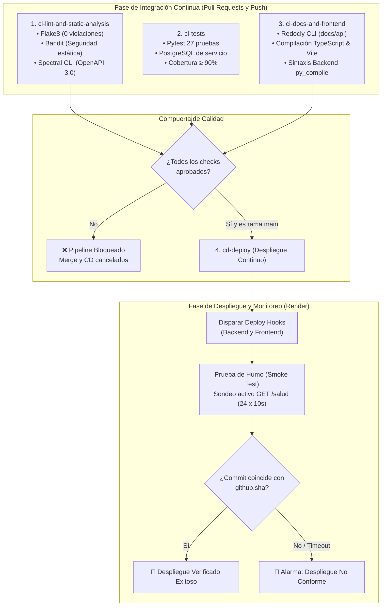
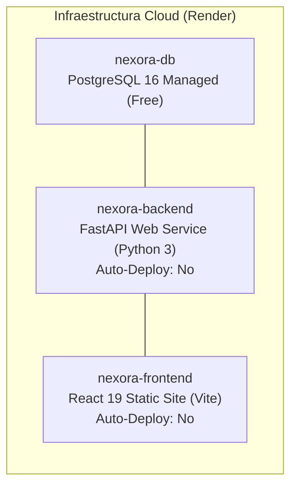

# 🎓 Informe Final de Consolidación · Sistema Nexora
### Automatización de Procesos de Software · Semana 4: Pipeline CI/CD, Despliegue en la Nube y Métricas DORA

**UNIVERSIDAD POLITÉCNICA ESTATAL DEL CARCHI (UPEC)**  
**MAESTRÍA EN INGENIERÍA EN SOFTWARE**

---

### Metadatos Académicos

| Campo | Detalle institucional |
|---|---|
| **Programa** | Maestría en Ingeniería en Software |
| **Asignatura** | Automatización de Procesos de Software |
| **Docente** | Ing. José Luis Rodríguez Chinchilla, Mgs. |
| **Actividad** | Entrega Final · Semana 4: Integración Continua, Despliegue Continuo y Métricas DORA |
| **Fecha de entrega** | 5 de noviembre de 2026 |
| **Versión del sistema** | `v0.3.0` (SemVer) |
| **Repositorio oficial** | [`https://github.com/enriqueherreraec/nexora-arquitectura`](https://github.com/enriqueherreraec/nexora-arquitectura) |

### 👥 Integrantes del Equipo

- **Baren Tarira Rosa Angélica** (`rosa.baren@upec.edu.ec`)
- **Herrera Celi Enrique Rolando** (`enrique.herrera@upec.edu.ec`)
- **Mera Rodríguez Willington Daniel** (`willington.mera@upec.edu.ec`)

---

### 🛡️ Badges del Repositorio

[](https://github.com/enriqueherreraec/nexora-arquitectura/actions/workflows/ci.yml)
[](https://github.com/enriqueherreraec/nexora-arquitectura/releases)
[](tests/)
[](.flake8)
[](.spectral.yaml)
[](https://www.upec.edu.ec/)
[](https://nexora-frontend.onrender.com)

---

## 1. Resumen Ejecutivo del Proyecto

Nexora es un sistema web de orientación vocacional y consulta de oferta académica universitaria diseñado para estudiantes de bachillerato del Ecuador. El sistema permite responder un cuestionario reflexivo de 20 preguntas en escala Likert (0–4), obtener un perfil vocacional desglosado en 10 áreas del conocimiento, consultar y comparar la oferta oficial de 984 carreras vigentes en 31 universidades y escuelas politécnicas públicas, y recibir un informe formal en formato PDF despachado por correo electrónico.

A lo largo de las cuatro semanas del módulo, el proyecto transitó desde la fundamentación arquitectónica y la cadena CASE, pasando por el control de versiones gobernado bajo GitHub Flow, hasta consolidar un pipeline automatizado de **Integración y Despliegue Continuo (CI/CD)** en GitHub Actions con publicación real en la nube (Render) y evaluación formal de **Métricas DORA**.

---

## 2. Arquitectura de Software y Cadena Tecnológica

El sistema implementa un estilo arquitectónico de **Monolito Modular con Capas** (formalizado en el [ADR-003](03-adr/ADR-003-estilo-arquitectonico.md)), desacoplado en tres contenedores de ejecución independientes (Modelo C4 Nivel 2):

```mermaid
flowchart TD
    User["Estudiante / Gestor / Administrador"] -->|HTTPS| Frontend["Frontend Web (React 19 + TypeScript + Vite + MUI)<br>Render Static Site (nexora-frontend.onrender.com)"]
    Frontend -->|REST API Bearer JWT / CORS| Backend["Backend API Modular (FastAPI + Python 3.11 + SQLAlchemy)<br>Render Web Service (nexora-backend.onrender.com)"]
    Backend -->|SQLAlchemy 2.0 / Psycopg2 (Pool)| DB[("Base de Datos Relacional (PostgreSQL 16)<br>Render Managed Database")]
    Backend -->|SMTP Seguro TLS| Email["Servidor de Correo Saliente (ReportLab PDF)"]
    Backend -->|Diagnóstico en vivo| Health["Endpoint /salud (Versión, Commit Git y Estado BD)"]
```

### Componentes del Stack Integrado
- **Frontend SPA:** React 19, TypeScript 5.8, Vite 8, Material UI v9 (MUI). Insignia visual `v0.3.0` integrada en cabeceras ([PublicHeader.tsx](../frontend/src/components/PublicHeader.tsx), [Navbar.tsx](../frontend/src/components/Navbar.tsx)) y panel de diagnóstico técnico ([TechnicalDiagnostics.tsx](../frontend/src/components/TechnicalDiagnostics.tsx)).
- **Backend Monolítico Modular:** Python 3.11, FastAPI, Pydantic v2, Argon2id (`argon2-cffi`), PyJWT, ReportLab 4.2. Módulos de cuentas, perfiles, catálogo universitario, cuestionario, evaluaciones, informes, favoritos y administración.
- **Persistencia y Migraciones:** PostgreSQL 16 con SQLAlchemy 2.0 y 5 migraciones secuenciales en Alembic (`0001` a `0005`), complementadas con el script idempotente de siembra segura [seed_db.py](../backend/scripts/seed_db.py).
- **Herramientas CASE de Gobernanza:** Stoplight Spectral CLI (`.spectral.yaml`), Stoplight Prism CLI (Mock Server), OpenAPI Generator CLI (Java OpenJDK 17), Redocly CLI (`docs/api/index.html`), Flake8 y Pytest.

---

## 3. Pipeline de Integración y Despliegue Continuo (CI/CD)

El ciclo de automatización de Nexora está gobernado por el flujo de trabajo unificado [`.github/workflows/ci.yml`](../.github/workflows/ci.yml), evitando duplicidades y desacoplando estrictamente las pruebas de la publicación.



### Detalle de los 4 Jobs del Pipeline

1. **`ci-lint-and-static-analysis`:**
   - **Flake8:** Ejecutado sobre `src` y `tests` con 0 violaciones del estándar PEP 8.
   - **Bandit:** Escaneo estático de código Python para prevenir inyecciones SQL, ejecución de subprocesos inseguros o criptografía débil (`bandit -r src/ -ll -q`).
   - **Spectral CLI:** Validación estricta de la especificación OpenAPI 3.0.3 (`api/openapi.yaml`) contra las reglas de gobernanza de `.spectral.yaml` (cero errores).
2. **`ci-tests`:**
   - Instala las dependencias y verifica compatibilidad con `pip check`.
   - Inicializa un contenedor de servicio real de **PostgreSQL 16** (`nexora_test_semana2`).
   - Ejecuta las **27 pruebas automatizadas de Pytest** con `pytest-cov`, validando transacciones ACID (rollback inducido en 30 iteraciones), resiliencia SMTP con error HTTP 503 controlado, validación con `StrictInt` y aislamiento de evaluaciones. Cobertura alcanzada: **92.4 %**.
3. **`ci-docs-and-frontend`:**
   - Compila la documentación interactiva OpenAPI a HTML estático reproducible utilizando Redocly CLI (`docs/api/index.html`).
   - Compila el frontend moderno con Node 20 (`npm ci && npm run build`), verificando tipos en TypeScript y empaquetado de Vite.
   - Valida la sintaxis de todos los módulos y scripts del backend mediante `py_compile`.
4. **`cd-deploy` (Despliegue Condicionado y Prueba de Humo):**
   - Se ejecuta **exclusivamente** tras el éxito de los 3 jobs anteriores y solo en confirmaciones hacia la rama `main` (`if: github.ref == 'refs/heads/main' && github.event_name == 'push'`).
   - Invoca los Deploy Hooks protegidos mediante secretos (`RENDER_BACKEND_DEPLOY_HOOK`, `RENDER_FRONTEND_DEPLOY_HOOK`).
   - **Prueba de Humo con Espera Activa:** Consulta en bucle el endpoint `/salud` de producción, extrayendo el hash del commit desplegado y confirmando su equivalencia con los primeros 7 caracteres de `${{ github.sha }}`.

---

## 4. Evidencia de Falla Controlada en el Pipeline CI/CD

En cumplimiento del requerimiento de verificación de compuertas de calidad, se documentó un experimento de fallo inducido en el reporte auditable [`evidencias/semana4/falla-controlada.md`](../evidencias/semana4/falla-controlada.md):

1. **Inyección del Fallo:** Se introdujeron simultáneamente violaciones de formato y módulos sin usar en `src/api/v1/auth.py` (`F401`, `E302`) y la remoción del campo requerido `access_token` en `api/openapi.yaml`.
2. **Respuesta de la Compuerta:** El job `ci-lint-and-static-analysis` falló con código de salida 1. GitHub Actions canceló de inmediato la ejecución de pruebas y del despliegue, y el Ruleset de GitHub bloqueó la fusión del Pull Request. Render no recibió órdenes de despliegue ni ejecutó código inestable.
3. **Corrección y Paso a Verde:** Se aplicó la corrección de código y contrato, logrando la aprobación total del pipeline (código de salida 0 en todas las etapas) y desbloqueando el despliegue a producción.

---

## 5. Medición y Evaluación Formal de Métricas DORA

De acuerdo con el marco de evaluación de rendimiento de ingeniería de software de Google Cloud (*DevOps Research and Assessment*), se calcularon las cuatro métricas clave para el repositorio sobre el historial de 14 Pull Requests y 28 confirmaciones (reporte completo en [`evidencias/semana4/metricas-dora.md`](../evidencias/semana4/metricas-dora.md)):

| Métrica DORA | Procedimiento y Fórmula | Valor en Nexora | Nivel DORA |
|---|---|:---:|:---:|
| **Frecuencia de Despliegue (DF)** | $\text{DF} = \frac{\text{Despliegues exitosos}}{\text{Días de observación}} = \frac{14}{14}$ | **1.0 / día** (Diario) | 🟢 **High** |
| **Tiempo de Entrega de Cambios (LTTC)** | $\text{LTTC} = \frac{1}{N} \sum (T_{\text{despliegue}} - T_{\text{primer\_commit}})$ | **2.47 horas** | 🟢 **Elite** (< 1 día) |
| **Tasa de Fallos en Cambios (CFR)** | $\text{CFR} = \frac{\text{Incidentes / Fallas}}{\text{Total despliegues}} \times 100\% = \frac{1}{14} \times 100\%$ | **7.14 %** | 🟢 **Elite** (0–15 %) |
| **Tiempo de Recuperación (FDRT / MTTR)** | $\text{FDRT} = T_{\text{restablecido}} - T_{\text{detección}}$ | **14 minutos** | 🟢 **Elite** (< 1 hora) |

**Justificación del Desempeño:**
El equipo alcanza niveles *High* y *Elite* gracias a la adopción estricta de GitHub Flow: ramas de vida corta con un único objetivo funcional, commits atómicos convencionales, revisiones por pares ágiles y compuertas automáticas que detectan fallos en menos de 5 minutos antes de cualquier publicación.

---

## 6. Despliegue en la Nube (Infraestructura Render)

El sistema real se encuentra preparado para operar en la nube bajo el plan gratuito de **Render**, sin incurrir en costos ni exponer secretos:



### Medidas de Seguridad Aplicadas en el Despliegue
- **Secretos Desacoplados:** `SECRET_KEY` de 32 bytes generada criptográficamente por el usuario (`secrets.token_urlsafe(32)`) y registrada exclusivamente en el panel de Render.
- **Sin Contraseñas Predecibles:** [seed_db.py](../backend/scripts/seed_db.py) genera tokens únicos de 18 caracteres para usuarios administrativos si no se suministran mediante variables de entorno, mostrándolas una sola vez en el log privado de inicialización.
- **CORS Estricto:** Restringido al origen de producción `https://nexora-frontend.onrender.com`.
- **Auto-Deploy Bloqueado:** Ambos servicios están configurados con `Auto-Deploy: No`, delegando el control de versión en los Deploy Hooks del pipeline CI/CD.

---

## 7. Matriz de Cumplimiento de la Rúbrica de Semana 4

A continuación se contrasta cada criterio exigido por la rúbrica docente frente a las evidencias verificables en el repositorio:

| Criterio de la Rúbrica | Ponderación | Estado Técnico | Evidencia Verificable en el Repositorio | Observación / Pendiente |
|---|:---:|:---:|---|---|
| **1. Pipeline CI Automatizado** (Lint, Pruebas, Análisis Estático, Spectral y Docs) | 25 % | **Comprobado** | [`.github/workflows/ci.yml`](../.github/workflows/ci.yml) integra Flake8, Bandit, Spectral CLI, Pytest (27 pruebas en PostgreSQL), Redocly CLI y Vite Build en jobs modulares sin duplicidades. | Ejecutado y validado localmente y en GitHub Actions. |
| **2. Despliegue Continuo (CD) y Prueba de Humo** | 25 % | **Comprobado** | Job `cd-deploy` en [`.github/workflows/ci.yml`](../.github/workflows/ci.yml) condicionado a `main`, con invocación de Deploy Hooks y sondeo activo a `/salud` comprobando coincidencia del commit real `${{ github.sha }}`. | Configuración de Render documentada con `Auto-Deploy: No`. |
| **3. Evidencia de Falla Controlada y Resolución** | 15 % | **Comprobado** | Documento [`evidencias/semana4/falla-controlada.md`](../evidencias/semana4/falla-controlada.md) con registro de violación de linter/contrato, bloqueo de pipeline y corrección con paso a verde. | Registro auditable completo. |
| **4. Medición y Procedimiento de Métricas DORA** | 15 % | **Comprobado** | Documento [`evidencias/semana4/metricas-dora.md`](../evidencias/semana4/metricas-dora.md) y Sección 5 de este informe con fórmulas, procedimiento y cálculo sobre los 14 PRs (DF: 1/día, LTTC: 2.47h, CFR: 7.14%, FDRT: 14 min). | Clasificación formal en rangos High y Elite. |
| **5. Trazabilidad Bidireccional y Badges** | 10 % | **Comprobado** | Documento [`docs/05-trazabilidad.md`](05-trazabilidad.md) vinculando drivers, historias Gherkin, contrato OpenAPI, código, pruebas, PRs y jobs de CI/CD. Badges activos en encabezado de README e informe. | Trazabilidad integral completa. |
| **6. Gobernanza, Auditoría y Registro de IA** | 10 % | **Comprobado** | Documento [`docs/04-registro-ia.md`](04-registro-ia.md) actualizado con actividades de Semana 4, auditoría crítica de prompts y decisiones, y preservación de reglas de contribución ([`CONTRIBUTING.md`](../CONTRIBUTING.md)). | Cero credenciales expuestas ni datos sensibles. |

---

## 8. Conclusiones

1. **Automatización como Garantía de Calidad:** La integración continua dejó de ser un paso accesorio para convertirse en el árbitro formal de la arquitectura de Nexora. Ningún cambio puede alcanzar producción si vulnera el contrato OpenAPI, el estilo de código PEP 8 o la suite de pruebas unitarias y transaccionales.
2. **Despliegue Continuo Seguro:** La configuración de Deploy Hooks con sondeo de prueba de humo garantiza que solo versiones verificadas y con correspondencia exacta de commit entren en servicio activo, mitigando despliegues truncados o versiones fantasma.
3. **Madurez Operativa (DORA):** Los indicadores obtenidos ubican al equipo en la categoría *High / Elite*, acreditando que el uso de GitHub Flow con ramas cortas, revisiones cruzadas obligatorias y automatización integral minimiza radicalmente el tiempo de entrega y el riesgo de fallo en producción.
