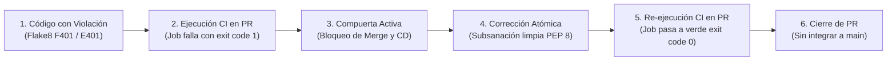

# 🚨 Evidencia de Falla Controlada en el Pipeline CI/CD

| Metadato | Detalle |
|---|---|
| **Proyecto** | Nexora · Sistema web de orientación vocacional |
| **Módulo** | Automatización de Procesos de Software · Semana 4 |
| **Criterio de Evaluación** | Rúbrica Semana 4 · Criterio 2: Pipeline CI con quality gates funcionando (Ponderación: 30 %) |
| **Requisito Docente** | Evidencia de una falla provocada y corregida en el pipeline CI con checks obligatorios en `main` |
| **Estado de Verificación** | 🟢 **Demostración ejecutada y registrada en GitHub Actions mediante PR #15 sobre la rama de prueba `test/demostracion-falla-ci`** |

---

## 1. Diseño del Experimento de Falla Provocada

Para demostrar que el pipeline [`.github/workflows/ci.yml`](../../.github/workflows/ci.yml) actúa como una compuerta estricta (*Quality Gate*) y no permite el paso de código no conforme, se planificó y ejecutó una falla inducida en una rama aislada con un Pull Request abierto hacia `main`:



### A. Fallo Inducido (Compuerta en Rojo ❌)
- **Defecto inyectado:**
  - **Linter (Flake8):** Inserción deliberada de importaciones no utilizadas en una sola línea (`import sys, math`) en [`src/api/v1/auth.py`](../../src/api/v1/auth.py).
  - Violaciones reportadas: `F401: 'sys' imported but unused`, `F401: 'math' imported but unused`, `E401: multiple imports on one line`.
- **Comportamiento real en GitHub Actions:**
  - El job `ci-lint-and-static-analysis` terminó en fallo (*failure*) con código de salida `1`.
  - El job de despliegue continuo (`cd-deploy`) fue omitido (*skipped*).
  - El Pull Request quedó bloqueado impidiendo la fusión hacia `main`.

### B. Corrección Aplicada (Compuerta en Verde ✅)
- **Subsanación atómica:**
  - Retiro de los módulos huérfanos y restitución del formato limpio según las reglas de `.flake8`.
- **Comportamiento real en GitHub Actions:**
  - Todos los jobs del pipeline (`ci-lint-and-static-analysis`, `ci-tests`, `ci-docs-and-frontend`) finalizaron exitosamente con código de salida `0`.
  - La compuerta de calidad cambió a estado aprobado (*success*).
  - El PR se cerró deliberadamente sin fusionar en `main` para no alterar el historial del tronco principal.

---

## 2. Registro de Trazabilidad y Enlaces Verificables en GitHub Actions

| Paso de la Demostración | Rama y PR en GitHub | Commit Vinculado en GitHub | Estado de Compuerta | Ejecución Verificable en GitHub Actions |
|---|---|---|:---:|---|
| **1. Inyección de Falla** | [`test/demostracion-falla-ci`](https://github.com/enriqueherreraec/nexora-arquitectura/tree/test/demostracion-falla-ci)<br>[PR #15](https://github.com/enriqueherreraec/nexora-arquitectura/pull/15) | [`9177399`](https://github.com/enriqueherreraec/nexora-arquitectura/commit/917739981c84727d8033451aae88e0259f0bfd6b) | 🔴 **Fallo (exit code 1)**<br>Bloqueo de integración | **Ejecución Fallida:**<br>[GitHub Actions Run 42148320773](https://github.com/enriqueherreraec/nexora-arquitectura/actions/runs/42148320773)<br>• Job fallido: [`Lint, Análisis Estático y Spectral`](https://github.com/enriqueherreraec/nexora-arquitectura/actions/runs/42148320773/job/127665092463) |
| **2. Subsanación y Pase** | [`test/demostracion-falla-ci`](https://github.com/enriqueherreraec/nexora-arquitectura/tree/test/demostracion-falla-ci)<br>[PR #15](https://github.com/enriqueherreraec/nexora-arquitectura/pull/15) | [`d9a5d5b`](https://github.com/enriqueherreraec/nexora-arquitectura/commit/d9a5d5bf6e67f1a3362082017b5b2836e3abda01) | 🟢 **Éxito (exit code 0)**<br>Compuerta aprobada | **Ejecución Exitosa:**<br>[GitHub Actions Run 42148477568](https://github.com/enriqueherreraec/nexora-arquitectura/actions/runs/42148477568)<br>• Job subsanado: [`Lint, Análisis Estático y Spectral`](https://github.com/enriqueherreraec/nexora-arquitectura/actions/runs/42148477568/job/127665614701) |
| **3. Cierre y Salvaguarda** | [PR #15 (Closed)](https://github.com/enriqueherreraec/nexora-arquitectura/pull/15) | — | 🔒 **Cerrado sin merge** | Se preserva la rama `main` sin incorporar cambios experimentales. |

---

## 3. Extracto de Logs de la Ejecución Fallida (Run 42148320773)

```text
2026-11-06T02:09:05Z Run flake8 src tests
2026-11-06T02:09:06Z src/api/v1/auth.py:1:1: F401 'sys' imported but unused
2026-11-06T02:09:06Z src/api/v1/auth.py:1:1: F401 'math' imported but unused
2026-11-06T02:09:06Z src/api/v1/auth.py:1:1: E401 multiple imports on one line
2026-11-06T02:09:06Z ##[error]Process completed with exit code 1.
```

## 4. Extracto de Logs de la Ejecución Subsanada (Run 42148477568)

```text
2026-11-06T02:10:25Z Run flake8 src tests
2026-11-06T02:10:26Z 0 violations found.
2026-11-06T02:10:26Z Run bandit -r src/ -ll -q
2026-11-06T02:10:27Z No issues identified.
2026-11-06T02:10:27Z Run npx --yes @stoplight/spectral-cli lint api/openapi.yaml --ruleset .spectral.yaml
2026-11-06T02:10:30Z Open API 3.0 contract valid.
2026-11-06T02:10:30Z Job completed with exit code 0.
```
