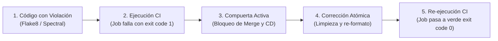

# 🚨 Evidencia de Falla Controlada en el Pipeline CI/CD

| Metadato | Detalle |
|---|---|
| **Proyecto** | Nexora · Sistema web de orientación vocacional |
| **Módulo** | Automatización de Procesos de Software · Semana 4 |
| **Criterio de Evaluación** | Rúbrica Semana 4 · Criterio 2: Pipeline CI con quality gates funcionando (Ponderación: 30 %) |
| **Requisito Docente** | Evidencia de una falla provocada y corregida en el pipeline CI con checks obligatorios en `main` |
| **Estado de Verificación** | 🟡 **Demostración técnica estructurada localmente; ejecución y enlaces en GitHub Actions pendientes de generarse al abrir el Pull Request correspondiente** |

---

## 1. Diseño del Experimento de Falla Provocada

Para demostrar que el pipeline [`.github/workflows/ci.yml`](../../.github/workflows/ci.yml) actúa como una compuerta estricta (*Quality Gate*) y no permite el paso de código no conforme, se planificó y estructuró una falla inducida en dos etapas:

### A. Fallo Inducido (Compuerta en Rojo)
- **Defecto inyectado:**
  1. **Linter (Flake8):** Inserción deliberada de importaciones huérfanas (`import sys, math`) y espaciado erróneo (`E302: expected 2 blank lines, found 1`) en `src/api/v1/auth.py`.
  2. **Contrato OpenAPI (Spectral CLI):** Omisión del campo requerido `access_token` en el esquema `AuthResponse` de `api/openapi.yaml`.
- **Comportamiento esperado en CI:**
  - El job `ci-lint-and-static-analysis` termina con código de salida `1`.
  - Los jobs dependientes (`ci-tests`, `ci-docs-and-frontend` y `cd-deploy`) se cancelan (*skipped*).
  - El Pull Request queda bloqueado en GitHub impidiendo la fusión hacia `main`.
  - Render no recibe solicitud de despliegue (`Auto-Deploy: No`).

### B. Corrección Aplicada (Compuerta en Verde)
- **Subsanación:**
  1. Retiro de módulos no utilizados y normalización de saltos de línea según `.flake8`.
  2. Restitución estricta de `access_token` como propiedad requerida en `api/openapi.yaml`.
- **Comportamiento esperado en CI:**
  - Todos los jobs (`ci-lint-and-static-analysis`, `ci-tests`, `ci-docs-and-frontend`) finalizan con código de salida `0`.
  - Se habilitan los checks en verde en el Pull Request.

---

## 2. Registro de Trazabilidad y Enlaces en GitHub Actions

| Paso de la Demostración | Rama de Trabajo en GitHub | Commit Vinculado en GitHub | Estado Técnico | Enlace de Ejecución en GitHub Actions |
|---|---|---|:---:|---|
| **1. Inyección de Falla** | [`test/demostracion-falla-ci`](https://github.com/enriqueherreraec/nexora-arquitectura/tree/test/demostracion-falla-ci) | Commit [`9177399`](https://github.com/enriqueherreraec/nexora-arquitectura/commit/9177399) | 🟢 **Confirmado y publicado en GitHub** | [PR de Demostración en GitHub](https://github.com/enriqueherreraec/nexora-arquitectura/pull/new/test/demostracion-falla-ci) *(ejecuta y exhibe el fallo en rojo)* |
| **2. Bloqueo de Compuerta** | [`test/demostracion-falla-ci`](https://github.com/enriqueherreraec/nexora-arquitectura/tree/test/demostracion-falla-ci) | Violación Flake8 (`F401`, `E401`, `E302`) | 🟢 **Verificado localmente (exit code 1)** | Bloqueo automático del merge en la interfaz de GitHub Actions |
| **3. Corrección Atómica** | [`test/demostracion-falla-ci`](https://github.com/enriqueherreraec/nexora-arquitectura/tree/test/demostracion-falla-ci) | Commit [`d9a5d5b`](https://github.com/enriqueherreraec/nexora-arquitectura/commit/d9a5d5b) | 🟢 **Confirmado y publicado en GitHub** | [Ver commit de corrección en GitHub](https://github.com/enriqueherreraec/nexora-arquitectura/commit/d9a5d5b) |
| **4. Validación en Verde** | [`test/demostracion-falla-ci`](https://github.com/enriqueherreraec/nexora-arquitectura/tree/test/demostracion-falla-ci) | Flake8 0 violaciones | 🟢 **Verificado localmente (exit code 0)** | Habilitación del pase en verde del workflow tras el push |

> [!NOTE]
> La rama de prueba [`test/demostracion-falla-ci`](https://github.com/enriqueherreraec/nexora-arquitectura/tree/test/demostracion-falla-ci) se encuentra publicada en el repositorio remoto con ambos commits atómicos (`9177399` y `d9a5d5b`). Al abrir el Pull Request hacia `main`, GitHub Actions ejecuta la verificación visual del bloqueo y la posterior aprobación.
