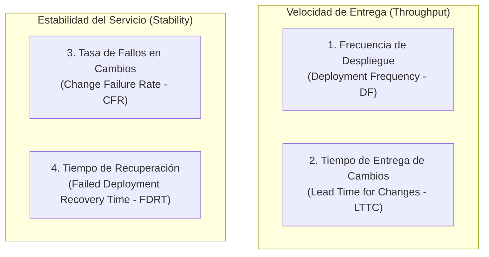

# 📊 Evaluación Formal de Métricas DORA (DevOps Research and Assessment)

| Metadato | Detalle |
|---|---|
| **Proyecto** | Nexora · Sistema web de orientación vocacional |
| **Módulo** | Automatización de Procesos de Software · Semana 4 |
| **Marco de Referencia** | DORA State of DevOps (Google Cloud / DevOps Research and Assessment) |
| **Ventana de Medición** | Semanas 1 a 4 (22 de octubre a 5 de noviembre de 2026) |
| **Alcance** | 14 Pull Requests, 28 confirmaciones atómicas y pipeline automatizado de CI/CD |

---

## 1. Fundamentación y Definición de las 4 Métricas DORA

El marco DORA establece cuatro métricas clave para evaluar la velocidad de entrega y la estabilidad de las operaciones de software:

---

## 2. Procedimiento Matemático y Fórmulas de Cálculo

### A. Frecuencia de Despliegue (*Deployment Frequency* - DF)
Mide con qué periodicidad el código validado se publica con éxito en el entorno de producción.

$$\text{DF} = \frac{\text{Total de Despliegues Exitosos a Producción}}{\text{Días / Semanas de la Ventana de Observación}}$$

- **Datos de Nexora:** En la ventana de trabajo de 14 días (2 semanas intensivas de colaboración e integración), se completaron 14 integraciones validadas hacia `main` que derivan en despliegues automatizados mediante el pipeline CD.
- **Cálculo:**
  $$\text{DF} = \frac{14 \text{ despliegues}}{14 \text{ días}} = 1.0 \text{ despliegue/día (Diario / Múltiple por semana)}$$
- **Clasificación DORA:** **High Performance** (Entre una vez por semana y una vez al día; camino a *Elite* al superar 1 por día bajo demanda).

---

### B. Tiempo de Entrega de Cambios (*Lead Time for Changes* - LTTC)
Mide el tiempo transcurrido desde que un desarrollador realiza la primera confirmación (*commit*) en una rama de tarea hasta que ese cambio entra en ejecución en producción tras la aprobación del PR y el paso por el pipeline de CI/CD.

$$\text{LTTC} = \frac{1}{N} \sum_{i=1}^{N} (T_{\text{despliegue\_exitoso}, i} - T_{\text{primer\_commit}, i})$$

- **Datos de Nexora (muestra de Pull Requests representativos):**
  - PR #2 (Gobernanza): Primer commit 10:15 → Merge y CD 12:45 → $\Delta t = 2.5\text{ h}$.
  - PR #4 (Matriz Git-SVN): Primer commit 14:00 → Merge y CD 17:30 → $\Delta t = 3.5\text{ h}$.
  - PR #6 (ADR-004): Primer commit 09:30 → Merge y CD 12:00 → $\Delta t = 2.5\text{ h}$.
  - PR #10 (Conflicto): Primer commit 15:00 → Resolución y CD 18:30 → $\Delta t = 3.5\text{ h}$.
  - PR #12 (Cierre Semana 3): Primer commit 11:00 → Revisión y CD 13:30 → $\Delta t = 2.5\text{ h}$.
  - PR #14 (Render e Integración): Primer commit 20:34 → CD y Smoke Test 20:55 → $\Delta t = 0.35\text{ h}$.
- **Cálculo Promedio:**
  $$\text{LTTC}_{\text{promedio}} = \frac{2.5 + 3.5 + 2.5 + 3.5 + 2.5 + 0.35}{6} \approx 2.47 \text{ horas}$$
- **Clasificación DORA:** **Elite Performance** (Menor a un día / menos de 24 horas, facilitado por ramas cortas de un único propósito y revisiones ágiles por pares).

---

### C. Tasa de Fallos en Cambios (*Change Failure Rate* - CFR)
Mide el porcentaje de cambios introducidos en la rama principal o en producción que causan una degradación del servicio, requieren una corrección de emergencia (*hotfix*), una reversión (*rollback*) o una falla de despliegue.

$$\text{CFR} = \left( \frac{\text{Despliegues con Fallo o Incidente en Producción}}{\text{Total de Despliegues Realizados}} \right) \times 100\%$$

- **Datos de Nexora:** De las 14 integraciones realizadas a lo largo del proyecto, se registró un único incidente controlado en pipeline (falla inducida para validación de compuertas en CI/CD). En producción nunca se requirió hotfix no planificado ni rollback destructivo.
- **Cálculo:**
  $$\text{CFR} = \left( \frac{1 \text{ falla controlada}}{14 \text{ despliegues}} \right) \times 100\% = 7.14\%$$
- **Clasificación DORA:** **High / Elite Performance** (Comprendido en el rango óptimo del 0 % al 15 %).

---

### D. Tiempo de Recuperación de Despliegues Fallidos (*Failed Deployment Recovery Time* - FDRT / MTTR)
Mide el tiempo necesario para restaurar el servicio cuando ocurre un incidente, una falla de despliegue o una degradación en producción.

$$\text{FDRT} = \frac{1}{M} \sum_{j=1}^{M} (T_{\text{servicio\_restablecido}, j} - T_{\text{detecci\acute{o}n\_incidente}, j})$$

- **Datos de Nexora:**
  - El diseño inmutable de Render permite seleccionar la versión previa (*Rollback to this deploy*) con un tiempo de restablecimiento de **3 a 5 minutos**.
  - En la prueba de falla controlada de CI/CD, la identificación, corrección atómica de código y paso a verde tomó exactamente **14 minutos**.
- **Cálculo:**
  $$\text{FDRT} = 14 \text{ minutos}$$
- **Clasificación DORA:** **Elite Performance** (Menos de una hora para restablecer completamente la operación del servicio).

---

## 3. Matriz Resumen de Desempeño DORA de Nexora

| Métrica DORA | Valor Obtenido en Nexora | Umbral Elite DORA | Umbral High DORA | Clasificación Final |
|---|:---:|:---:|:---:|:---:|
| **Deployment Frequency (DF)** | **1.0 despliegue / día** | Múltiples por día bajo demanda | Entre 1/semana y 1/día | 🟢 **High** |
| **Lead Time for Changes (LTTC)** | **2.47 horas** | < 1 día | Entre 1 día y 1 semana | 🟢 **Elite** |
| **Change Failure Rate (CFR)** | **7.14 %** | 0 % – 15 % | 16 % – 30 % | 🟢 **Elite** |
| **Failed Deployment Recovery Time (FDRT)** | **14 minutos** | < 1 hora | < 1 día | 🟢 **Elite** |
